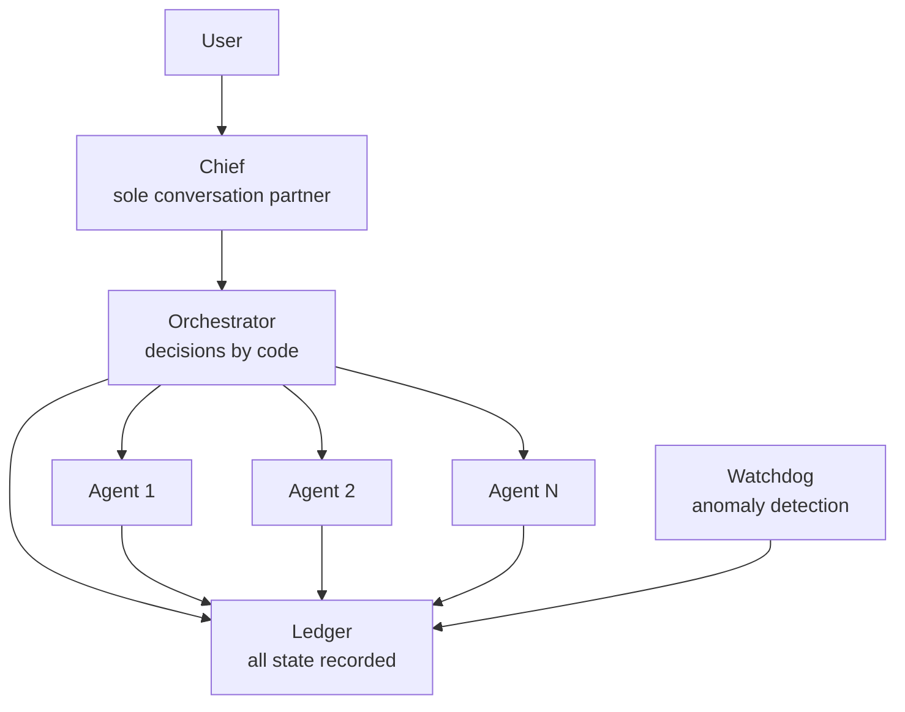

+++
date = '2026-08-16T23:00:00+09:00'
draft = false
title = '[2026-08-16] Elegance Is a Cost'
summary = "We started building a personal Agent OS. The first principle: 'elegance is a cost' — we would not build write paths that no one reads."
tags = ['HIA']
+++

From August 15 through 16, we laid the foundation of HIA (Hermes-Inspired Architecture).

---

## What Is HIA

HIA is a personal Agent OS for a single user. A team of specialized agents collaborates in sequence, and the user only ever talks to one: Chief. Three core principles:

1. **All state lives in the ledger** — recorded in a shared journal, not in an agent's head
2. **All decisions are made by code** — models produce content only; code determines the next step
3. **Elegance is a cost** — we do not build event sourcing, type hierarchies, or four-layer module boundaries

## Three Design Decisions

**First, we chose headless execution.** Instead of agents conversing inside a terminal session, they run in the background and write results to the ledger. This means losing streaming output and the ability to interrupt a running agent. In return, we get deterministic control over resets and re-execution. **We knew what we were giving up and chose anyway.**

**Second, we set third-party runtime dependencies to zero.** There must be zero additional operating cost. For a tool used by one person, we would not take on external service charges or maintenance burden. (Later, we made a single exception for a PostgreSQL driver — the subprocess approach failed on newline handling.)

**Third, "elegance is a cost."** Event sourcing, type hierarchies, four-layer module boundaries — these earn their keep when the team is large and many people read the code. In a one-person system, they only **add write paths that no one reads.** All excluded.

## Result

In two days, we had a working 4-zone ledger (PLAN, STATE, LOG, STATUS), orchestrator, watchdog, Chief, and flow engine. A practical demonstration of "elegance is a cost" — keeping the structure simple let us build something that runs, fast.
