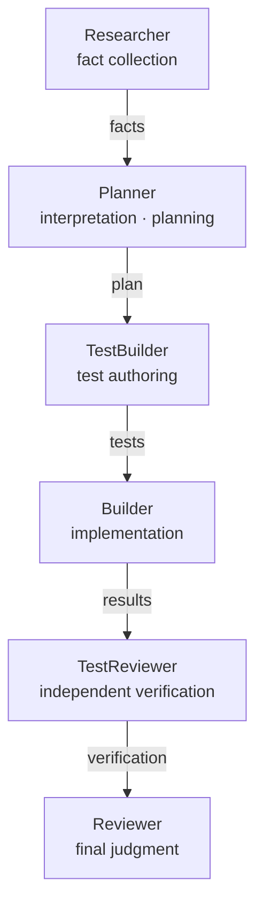

+++
date = '2026-08-17T23:00:00+09:00'
draft = false
title = '[2026-08-17] Separate Fact from Interpretation'
summary = "We expanded the Agent OS from four roles to six. The key moves: splitting research from planning, and refusing to trust an agent's self-report."
tags = ['HIA']
+++

On August 17, we expanded HIA's agent roles from four to six.

---

## Why We Split the Roles

In the previous structure, the Planner handled both research and planning. The problem was that **fact-gathering and interpretation were tangled inside a single agent.** "How does this code work?" (fact) and "So how should we fix it?" (interpretation) are fundamentally different tasks. When one agent does both, it tends to fit its interpretation to match the facts it collected.

**We added a Researcher.** Its job is to collect facts and nothing else — no interpretation. The Planner receives the facts the Researcher collected and builds the plan from there.

## Don't Trust an Agent's Self-Report

When the Builder reports "tests passed," can we take that at face value? **We decided not to.**

**We added a TestReviewer.** It independently verifies the code the Builder wrote and the test results. It's not the Builder's "passed" report but the TestReviewer's verification that determines whether to proceed.

## What We Didn't Add

We left out Feedback (failure root-cause analysis) and Janitor (cleanup) at this point. HIA was a serial single-pass system — once the pipeline runs, it's done. There was no mechanism yet to carry failure feedback into the next run. Building a role for a structure that doesn't exist would produce an empty shell.

We also didn't introduce a judgment enum. The ledger's DONE/FAILED is the judgment. In a one-person system, formality for formality's sake is unnecessary.

## Decision Summary

| Decision | Reason |
|---|---|
| Add Researcher | Separate fact from interpretation |
| Add TestReviewer | Don't trust agent self-reports |
| Skip Feedback · Janitor | No role in serial single-pass execution |
| Skip judgment enum | DONE/FAILED is sufficient |
