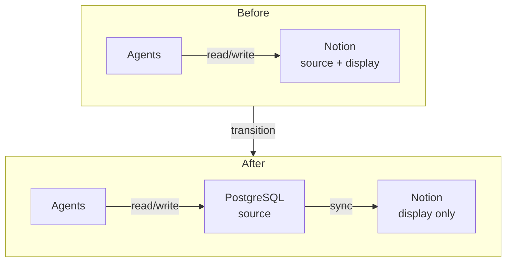

+++
date = '2026-08-21T23:00:00+09:00'
draft = false
title = '[2026-08-21] DB Is the Source, Notion Is the Skin'
summary = "We moved the ledger's authority from Notion to PostgreSQL. Existing data stays in Notion — no migration. New runs go to the DB, old ones remain where they are."
tags = ['HIA']
+++

On August 21, we moved HIA's ledger authority from Notion to PostgreSQL.

---

## Why We Moved

HIA's ledger started as a Notion page. Every agent read from and wrote to Notion to share state. The problem was that **if Notion went down, the entire system stopped.** The ledger is the system's heart, and that heart depended on an external service's availability.

The decision was clear. **"DB is the source, Notion is the skin."** All decisions happen in PostgreSQL, and Notion was demoted to a display-only layer for human convenience. If Notion dies, the system keeps running.

## No Migration

We decided not to migrate existing run history from Notion to the DB.

The reason is simple. As a one-person system, we can tolerate dual storage. Past records stay in Notion; new runs go to the DB. Migration would require effort disproportionate to its benefit — if we ever need to reference past records, we can just look at Notion directly.

## Principles Carried Over, Things Deferred

Even with the move to a DB, **the append-only principle was preserved.** Domain tables allow INSERT only. The principle we followed in Notion carried straight over to the DB.

On the other hand, CAS (Content-Addressable Storage), audit chain, and idempotency keys were deferred. These are useful but not immediately necessary. Following the "elegance is a cost" principle, we'll add them when the need arises.

| Decision | Reason |
|---|---|
| DB as source of truth | Prevent Notion outage = system halt |
| Notion retained as skin | Still convenient for human viewing |
| No migration | One-person system, dual storage acceptable |
| Append-only preserved | Principles hold regardless of storage change |
| CAS · audit · idempotency deferred | Not needed now, add when needed |
