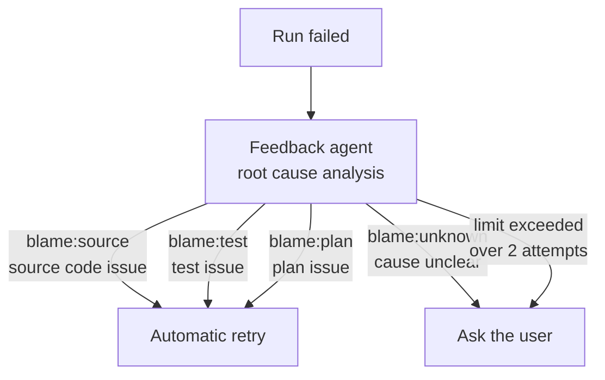

+++
date = '2026-08-23T23:00:00+09:00'
draft = false
title = '[2026-08-23] Retry Without Asking'
summary = "We turned Chief from a standalone process into a skill, chose SQL over vector search, and made the biggest call: allowing automatic retries — retiring the invariant that said 'never retry without user consent.'"
tags = ['HIA']
+++

From August 22 through 23, we redesigned HIA's Chief and built the automatic retry system.

---

## Deleting the Chief Process

Chief originally ran as a separate process (`bin/hia-chief`). The user explicitly refused to keep it. **The Claude Code skill (`/chief`) became the sole interface.**

This eliminated the subprocess layer entirely. The Claude Code session itself acts as Chief. Runs take tens of minutes to hours, so they're kicked off in the background.

## SQL Instead of Vector Search

When adding the ability to search past run history (RAG), we chose **SQL-based search** over vector search. In a one-person system, all data is structured in PostgreSQL. There's no reason to add embedding models or a vector database. Structured queries for structured data.

## Automatic Retry — Retiring an Invariant

This was the biggest decision.

Until now, there had been an invariant: **"never retry without user consent."** Whenever an agent failed, the system always asked the user before trying again. We retired this invariant.

The Feedback agent analyzes failed runs and assigns blame. Depending on the blame type:

**When the cause is clear (source/test/plan), retry immediately without asking.** When the cause is unknown (`blame:unknown`) or retries exceed the limit (2 attempts), always ask the user.

Retrying within the same run would cause blame cycles, so we chose to **create a new run** that restarts from the failed role.

## A Known Limitation

We discovered a structural limitation: even when Feedback assigns blame:test, the TestBuilder's DONE status persists, preventing its output from being rewritten. A stage invalidation mechanism is needed, but we deferred it. **Recognizing and recording the limitation** is itself a deliverable from this work.

| Decision | Before | After |
|---|---|---|
| Chief execution model | Standalone process | Claude Code skill |
| History search | None | SQL-based RAG |
| Retry policy | Always ask user | Automatic when blame is clear |
| Retry limit | None | 2 attempts |
