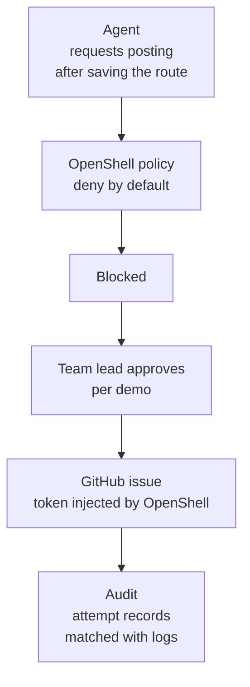

+++
date = '2026-10-07T12:00:00+09:00'
draft = false
title = '[2026-10-07] Posting Is Blocked, and Goes Through Once Approved'
summary = "For the scene that would show deep use of OpenShell, we chose 'posting blocked → approved → goes through.' We deliberately picked GitHub issue posting, which needs a token, to show OpenShell inserting the token on the agent's behalf."
tags = ['NVIDIA Hackathon']
aliases = ['/posts/dev/nvidia-hackathon/2026-10-07-finals-publish-gate/', '/posts/dev/nvidia-hackathon/finals/2026-10-07-finals-publish-gate/']
+++

Once the direction was set, design questions poured in all at once. Among them, I've gathered the decisions that directly touch OpenShell use, which carried 40 points in the judging.

---

## Background: "We Ran It in a Sandbox" Doesn't Count as Use

There was a standard we set in the preliminary round. Merely running in a sandbox is just hygiene; it only counts as use when the core flow **structurally depends** on features like policy blocking or credential separation. So we put at the center of the demo a scene where policy blocks the "posting" after a route is saved, and it opens once a person approves.

## Posting Target

| Plan | Judgment |
|---|---|
| A keyless public service (the recommended plan) | Dropped — can't show token injection |
| A local mock bulletin board | Dropped — not a real external boundary |
| **A service that needs a token (GitHub)** | **Adopted** — shows OpenShell inserting the token on the agent's behalf |

We narrowed the posting location to **issues on a dedicated repository**, and made the token one that only has issue-write permission on that repository. Least privilege, the narrowest approval rule. We also pre-approved a fallback path to a keyless public service in case token injection didn't work within 45 minutes.

We also settled how to register the token. Instead of putting it in `.env` and adding more key wrappers, **the team lead registered it directly as a provider in the terminal**. The token doesn't remain anywhere: not in the conversation, files, or logs.

## Design Principles We Set Alongside

- **Evidence grades have 4 levels, are based on source type, and are calculated by code.** The same material has to produce the same grade. We dropped the plan of leaving it to the model's judgment.
- **The model makes the plan first, and code executes it.** It's easier to record and reproduce than having the model choose a tool at every step.
- **The secrets scene**: actually attempt to read the off-limits folder with the read tool, and leave the denial (EACCES) in the decision log. OpenShell doesn't log file denials, so we show it paired with the network denial log.
- When dates and grades conflict in operating information, show both and write "on-site verification needed."

## What We Accepted

For the unit of posting approval, we chose **per demo** rather than the recommended plan (one-time approval). We knew and accepted the risk that other runs could also post while the approval was open. We needed the approval scene to go smoothly within a 5-minute presentation.

## Afterward

In the afternoon, we ran the violation tests, and the results all matched predictions. Posting was blocked, then after approval the issue actually went up, and we revoked the approval. The audit script matched every one of the app's posting-attempt records with all 21 OpenShell log entries.

