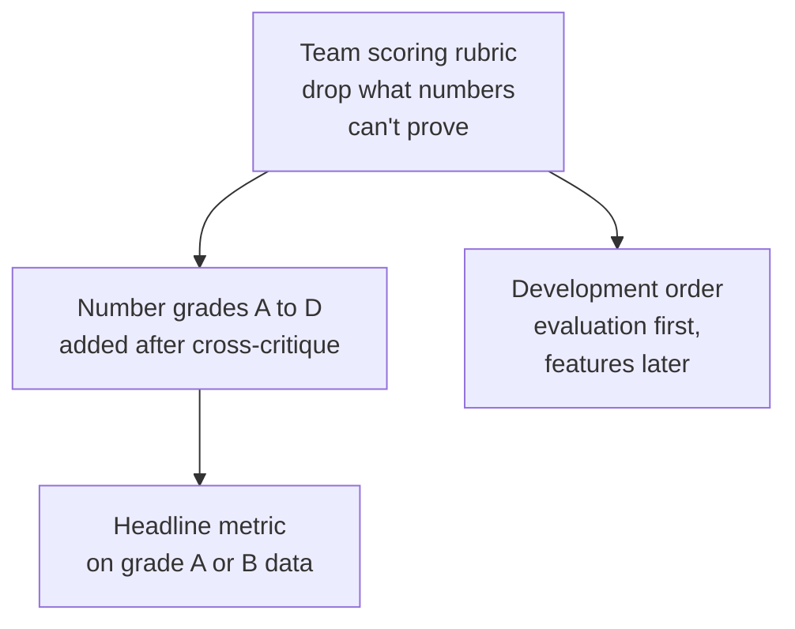

+++
date = '2026-09-22T23:00:00+09:00'
draft = false
title = "[2026-09-22] If We Can't Prove It with Numbers, We Don't Build It"
summary = "Starting the NVIDIA Korea Agentic AI Hackathon preliminary round, we set a scoring rubric before choosing any idea. The first principle: 'we do not adopt ideas we cannot prove with numbers.'"
tags = ['NVIDIA Hackathon']
aliases = ['/posts/dev/nvidia-hackathon/2026-09-22-numbers-or-nothing/', '/posts/dev/nvidia-hackathon/preliminary/2026-09-22-numbers-or-nothing/']
+++

On the first day of preparing for the preliminary round of the 2026 NVIDIA Korea Agentic AI Hackathon, before picking an idea, we first built the criteria for filtering ideas.

---

## Background: We Read the Competition First

We checked the official page, the application form, the DLI (NVIDIA's training courses) lectures, and build.nvidia.com ourselves, and wrote a research document. The preliminary deadline was September 28 at 23:59, and the process was "review the training mission → build a demo using NVIDIA APIs → submit the application." There were four judging criteria (depth of NVIDIA Agent technology use; practicality, industrial value, and innovation; completeness; originality), but the point weights were not published. Since the training mission covered NemoClaw (NVIDIA's reference stack for running agents on top of OpenShell) and OpenShell (a sandbox runtime that runs agents in isolation), we figured the tech stack was effectively decided.

One thought came out of this. **Anyone can build an agent demo.** So where does the difference come from?

## Options

| Direction | Description | Result |
|---|---|---|
| Idea first | Pick a fun topic and stack features on it | Dropped — the demos become indistinguishable |
| Win on tech count | Attach as many NVIDIA technologies as possible | Dropped — count is not necessity |
| **Rubric first** | Keep only ideas we can prove with numbers | **Adopted** |

## What We Chose: A Team Scoring Rubric

The first principle was "we do not adopt ideas we cannot prove with numbers." We attached six hard gates to it (quantitative proof, fit with the training mission, at least three NVIDIA technologies, reproducibility, a real industry problem, finishable within six days). These were not the competition's official weights but design rules the team set for itself. Filtering 10 candidates through this rubric eliminated scheduling/travel, document generation, and general-purpose chatbot RAG (retrieval-augmented generation).

That night we widened the pool to 23 candidates and asked ChatGPT to play a "ruthless judge" for a cross-critique. We accepted three of its points.

- **Mistaking the number of technologies for necessity** — we have to ask, "Does it still work if you remove OpenShell?"
- **Confusing being able to produce a number with that number being evidence.**
- **Growing the product narrative before the core experiment.**

So we added number grades to rubric v2.1. A is an external benchmark or real labels, B is a frozen held-out set, C is an independently built deterministic fixture, and D is "synthetic data we made and we scored." The headline metric has to be A or B.

There was also advice we rejected. ChatGPT said "lock in one of the two candidates and don't add new ideas," but we didn't follow it. We wanted to leave room to widen the candidates toward real-world work the next day.

## What This Choice Meant

The rubric even set the development order. **Evaluation scripts and baselines first, features later.** If you don't want to change the rules after seeing the results, the rules have to exist first. Two days later, this order became the basis for the design decision "documents first, implementation next," and the number-grade system became the basis for moving the headline metric from synthetic data to real data.

## Afterward

This rubric remained the standard to the end. When a format error occurred in the sealed evaluation and we wrote "Grade A claim withheld" instead of rescoring, that judgment also came from the principle set on this day.
