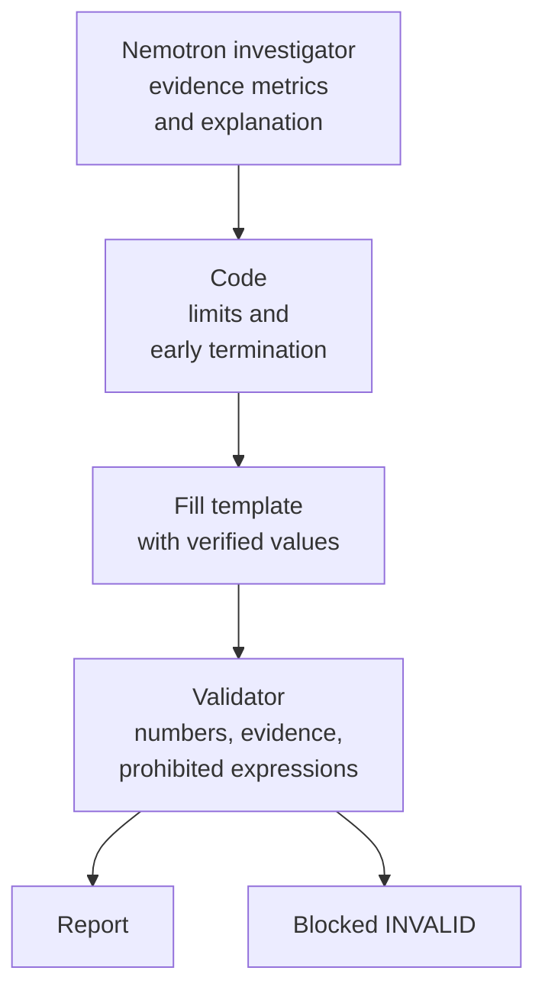

+++
date = '2026-09-23T22:10:00+09:00'
draft = false
title = '[2026-09-23] Block It with Code, Not Instructions'
summary = "The model ignored an instruction to 'hold without further lookups' and flipped a share decrease into an increase. That night we set the principle that code, not the model, is responsible for numbers and limits."
tags = ['NVIDIA Hackathon']
aliases = ['/posts/dev/nvidia-hackathon/2026-09-23-code-over-instructions/', '/posts/dev/nvidia-hackathon/preliminary/2026-09-23-code-over-instructions/']
+++

On the night we settled on our topic, we fixed the collector and called the model for real for the first time. That single observation became the backbone of the entire design that followed.

---

## Background: Collector Defects and a Model That Broke Its Instructions

First, we fixed five defects in the Korea Customs Service import statistics collector. The item-level API returns 10-digit rows even when you request a 4-digit item (HS4), but we had assumed the same structure, so pairs that weren't targets got mixed into the aggregates and the share denominator went unverified. After the fix, we added one more item and collected again under a new snapshot (data collected at one point in time and frozen) ID.

Next, we tested a tool-call round trip with NIM (NVIDIA's cloud inference API). The result was shocking.

- The model ignored the instruction to "hold without further lookups" and called more tools.
- A response that flipped a share **decrease** into an **increase** passed through as-is.

## Options

| Method | Description | Judgment |
|---|---|---|
| Stronger instructions | Write the rules more forcefully in the prompt | Dropped — we had just watched the instructions get ignored |
| Model writes numbers, reviewed afterward | The model writes the report's numbers itself | Kept only as a comparison baseline (`freeform`) |
| **Code enforces** | Code handles limits, early termination, and filling in numbers | **Adopted** |

## What We Chose: Code Enforces

We set the principles like this.

- **Early termination, tool-call limits, and blocking repeat calls with identical arguments are enforced by code.** OpenShell policies can't cap call counts, so the app code takes that on.
- **Numbers are filled into a template from verified values.** The model outputs "which metrics to use as evidence" and the explanation; code pulls the actual values from the snapshot and inserts them.
- **The validator blocks.** Code checks the report's numbers, evidence, and prohibited expressions, and doesn't let it through if anything is off.

We also decided on a re-collection method. We dropped "delete and reinsert" because a failed re-collection could overwrite good raw data; when settings change, we don't touch the frozen snapshot but collect under a new snapshot ID.

## What This Choice Meant

This decision gave the evaluation something to compare. If you run `freeform`, where the model writes numbers directly, and `full`, which fills in verified values and lets the validator block, under the same conditions, you can measure "how much the structure reduces factual errors." The difference between the two modes on the headline metric ultimately came from here.

## Afterward

This principle was confirmed again and again throughout development. Fixing the wording of instructions always had a small effect; what worked was code boundaries.
