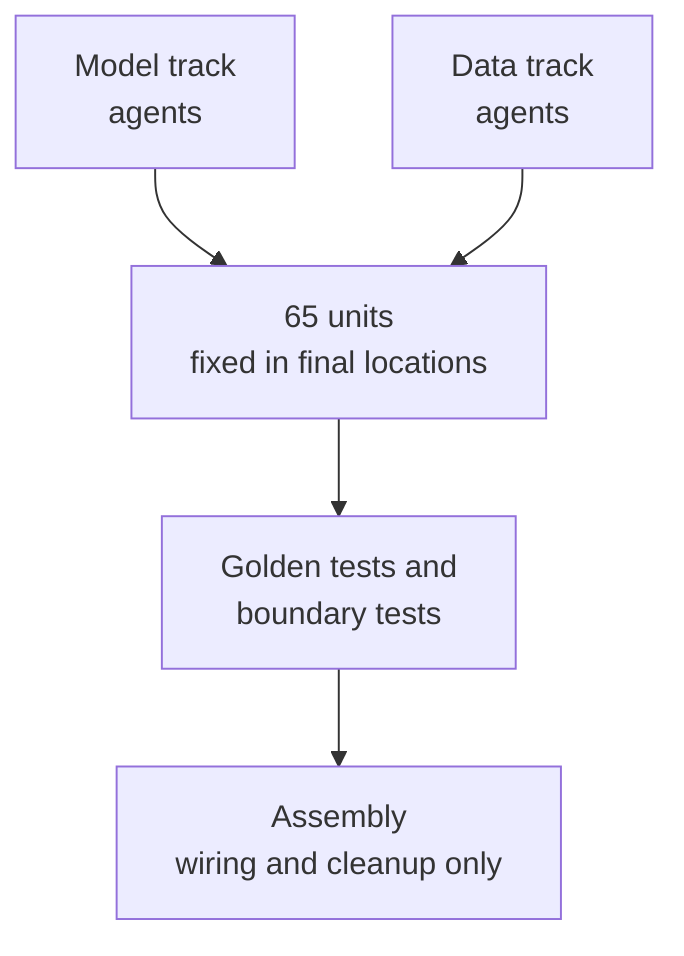

+++
date = '2026-09-24T17:20:00+09:00'
draft = false
title = '[2026-09-24] Build in 65 Units, Assemble at the End'
summary = "So that agents on two tracks could implement at the same time, we split the app into 65 minimal units and put them in their final locations from day one. The choice was meant to make assembly nothing more than wiring and cleanup, with no moving of files."
tags = ['NVIDIA Hackathon']
aliases = ['/posts/dev/nvidia-hackathon/2026-09-24-units-then-assemble/']
+++

On the afternoon of September 24, with the planning documents done and implementation ahead, we decided how to divide up the implementation.

---

## Background: When Many Agents Edit at Once, Things Get Mixed Up

Agents on the two tracks were going to work simultaneously, six to eight each. When several of them edit the same file, conflicts happen, and later, when merging, you lose any basis for judging what to discard and what to combine. So I set three conditions.

1. As the foundation, implement the app separately by domain and then assemble it.
2. Split each domain again into minimal units.
3. When assembling, check what to discard and what to combine.

I also gave the naming and output rules verbatim. "Make names and rules clear. Each domain's outputs pile up in ./outputs/." Each run's output goes into a `{domain-name}-{yymmddhhmmss}` folder, and sealed-set output goes separately into `outputs/sealed/`.

## Options

| Plan | Description | Judgment |
|---|---|---|
| **Plan A** | Turn modules into packages and put unit files in their final locations from day one (import paths kept) | **Adopted** |
| Plan B | Keep the paths, put the units as functions inside files | Dropped — function-level units blur ownership and review boundaries |
| Plan C | Make each unit an installable package | Dropped — packaging costs too much for a five-day project |

## What We Chose: Plan A

If unit files sit in their final locations from day one, assembly finishes **with wiring and cleanup, without moving files**. The result was a unit table listing each unit's ID, domain name, file, owner, and assembly verdict candidate. There ended up being 65 minimal units.

That same night we decided one more thing. We had decided to get outside advice on the app skeleton (S0), but while waiting for that advice, neither track could start. I replied, "We're not incorporating any more outside advice," and had the skeleton work propose answers to open questions and the orchestrator settle them as decision records.

## What This Choice Meant

The S0 skeleton created 15 packages and boundary tests. The boundary tests enforced rules such as "the independent scorer does not import the app" without executing code, and caught all 62 intentionally planted violations. We set aside a slot for a golden test (a test that compares against expected output) for each unit, so that any contract mismatch between units would surface immediately.

## Afterward

The next day, the assembly check (AS4) ran the six-step procedure from the unit table and concluded that "nothing was combined and nothing was discarded." Not once did we have to move files right before assembly.
