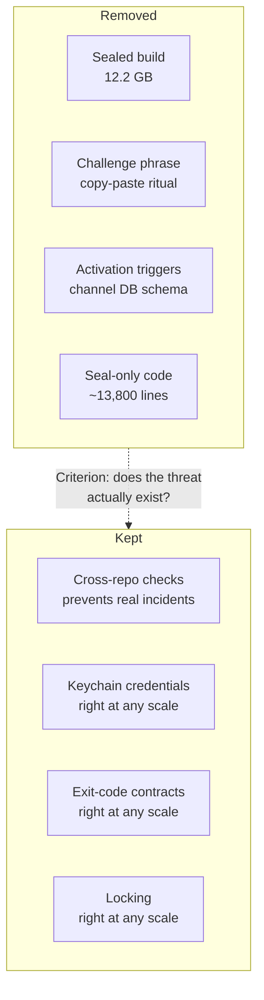

+++
date = '2026-08-08T23:00:00+09:00'
draft = false
title = '[2026-08-08] Shedding Unnecessary Armor'
summary = "A protective layer guarding against a nonexistent threat had been stalling the project. We deleted 13,800 lines and kept only what was right regardless of scale."
tags = ['Second Brain']
+++

From August 4 through 8, we tore out the entire seal/activation layer from Second Brain.

---

## Why We Removed Everything

The seal layer was designed around a premise: "someone might change the code without the owner knowing." It required creating a sealed build and entering a challenge phrase before any feature would unlock.

But this is a system that one person runs on their own Mac. The only one who can change the code is me, and there's only one deployment path. **The threat it was guarding against didn't exist.** And this protective layer had actually been stalling the project for weeks — every time sealing failed, progress was blocked, and the resealing process itself was a burden.

The question-to-answer path was already running continuously, independent of the seal. Nothing new was needed in its place.

## What We Removed, What We Kept

The criterion was simple. **"Does the threat this mechanism guards against actually exist?"** The seal, challenge phrase, and activation triggers were guarding against a nonexistent threat. Cross-repo checks, on the other hand, prevent real incidents as long as two processes share a physical touchpoint. Keychain and exit-code contracts are good practice regardless of system scale.

## Decision Summary

| Option | Decision | Reason |
|---|---|---|
| Keep some seals vs. remove all | **Remove all** | The threat doesn't exist |
| Migrate channel DB vs. start fresh | **Start fresh** | Activation remnants baked into schema triggers, inseparable |
| Keep challenge phrase vs. remove | **Remove** | Whitelist + DM already serves the same role |
| Archive seal artifacts vs. delete | **Delete immediately** | 12.2 GB, no reason to keep |

We decided to start the channel DB from scratch. Activation state was baked into the schema as triggers and couldn't be separated out. Rather than leaving remnants, we chose a clean start.
