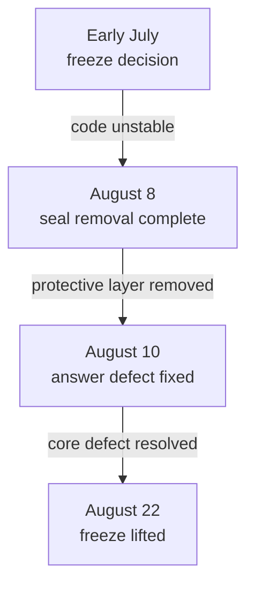

+++
date = '2026-08-23T23:00:00+09:00'
draft = false
title = '[2026-08-23] Lifting the Freeze'
summary = "We turned on four features that had been frozen for nearly two months. The classifier was also swapped to a more accurate model. The freeze was caution; lifting it was caution too."
tags = ['Second Brain']
+++

From August 22 through 23, we activated frozen features and replaced the classifier in Second Brain.

---

## Turning On Four Features

We explicitly activated four features that had been switched off since early July.

- **Dream cycle** — a background job that periodically reorganizes stored memories
- **Synthetic review** — automatically checks memory quality
- **Snapshot publish** — exports the memory state externally
- **Reengagement review** — draws attention back to long-unused memories

The code had existed from the start. Only the configuration flags were off. The previous policy was **"do not turn these on until the seal is lifted."** The seal had already been removed (August 8), and the answer defect had been fixed since then, so we judged the code stable enough.

For the reengagement review, we at first considered targeting only core memories (shell memory), but decided to **apply it to all memories.** Priority signals are independent of a memory's tier.

## Classifier Replacement

We replaced the speech-act classifier — the component that identifies user intent.

The previous classifier split the input into small chunks (`_split_chunks`) and classified each chunk's intent separately. The problem was that context was destroyed during the split. Splitting "What should I do this weekend?" into "What should I do" and "this weekend?" makes it impossible to determine intent from each piece alone.

The root cause wasn't the splitting algorithm — it was **the design of classifying at the chunk level itself.** We replaced the classifier with one that looks at the entire document at once.

| Aspect | Before | After |
|---|---|---|
| Classification unit | Sentence chunk | Entire document |
| Context preservation | Lost during splitting | Fully preserved |

The existing split function (`_split_chunks`) was still used elsewhere, so it wasn't deleted. Only the classifier was replaced.
