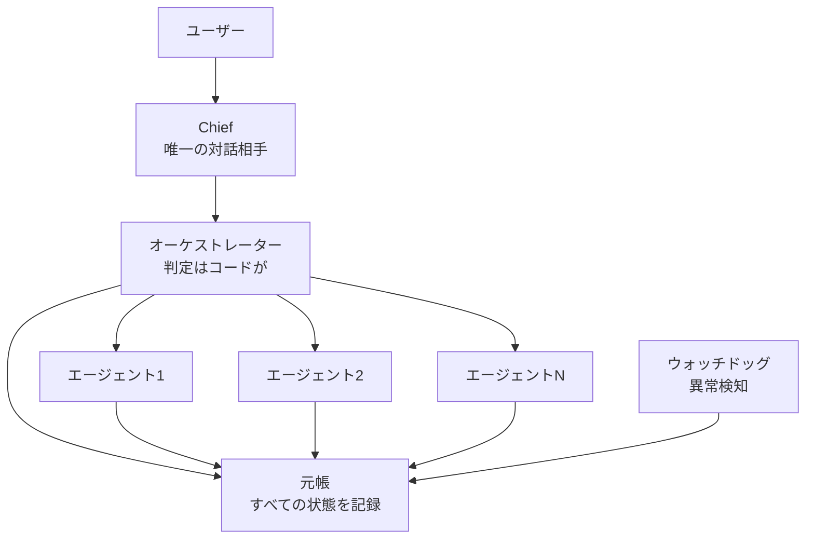

+++
date = '2026-08-16T23:00:00+09:00'
draft = false
title = '[2026-08-16] エレガンスはコストだ'
summary = "個人用Agent OSを作り始めた。最初の原則は「エレガンスはコストだ」——誰も読まない書き込み経路を作らないことにした。"
tags = ['HIA']
+++

8月15日から16日まで、HIA（Hermes-Inspired Architecture）の基礎を築いた。

---

## HIAとは何か

HIAは一人のユーザーのための個人用Agent OSだ。専門エージェントチームが直列で協働し、ユーザーが対話するのはChiefの一つだけ。三つの基本原則がある：

1. **状態はすべて元帳（ledger）に**——エージェントの頭の中ではなく、共有帳簿に記録
2. **判定はすべてコードが**——モデルは内容を作るだけで、次のステップを決めるのはコード
3. **エレガンスはコストだ**——イベントソーシング、型階層、4層モジュール境界は作らない

## 三つの設計判断

**第一に、ヘッドレス（画面なしの実行）を選択した。** エージェントがターミナルセッション内で対話する代わりに、バックグラウンドで実行して結果を元帳に書き込む。これによりストリーミング出力と実行中の割り込み（interrupt）機能を失う。代わりにリセットと再実行の決定論的制御が得られる。**失うものを理解した上で選択した。**

**第二に、サードパーティのランタイム依存をゼロにした。** 運用の追加コストがゼロでなければならない。一人で使うツールに外部サービスの課金や管理負担を背負わないという判断だ。（後にPostgreSQLドライバだけ唯一の例外として許可した——サブプロセス方式が改行処理で失敗したためだ。）

**第三に、「エレガンスはコストだ。」** イベントソーシング、型階層、4層モジュール境界——これらはチームが大きくコードを読む人が多い時に価値を発揮する。一人のシステムでは**誰も読まない書き込み経路が増えるだけだ。** すべて除外した。

## 結果

二日間で4ゾーン元帳（PLAN・STATE・LOG・STATUS）、オーケストレーター、ウォッチドッグ、Chief、フローエンジンが動作するようになった。「エレガンスはコストだ」の実証——構造をシンプルに保てば、動くものを速く作れる。
