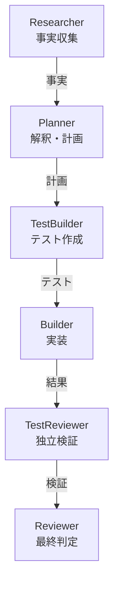

+++
date = '2026-08-17T23:00:00+09:00'
draft = false
title = '[2026-08-17] 事実と解釈を分離せよ'
summary = "Agent OSの役割を四つから六つに増やした。核心は調査と計画の分離、そしてエージェントの自己報告を信用しないという原則だった。"
tags = ['HIA']
+++

8月17日、HIAのエージェントの役割を4つから6つに拡張した。

---

## なぜ役割を分けたのか

従来の構造ではPlannerが調査と計画の両方を担当していた。問題は**事実の収集と解釈が一つのエージェント内で混在していた**ことだ。「このコードはどう動くか」（事実）と「ではどう直すべきか」（解釈）は性質の異なる作業だ。一つのエージェントが両方をやると、自分が集めた事実に合わせて解釈をこじつける傾向が生まれる。

**Researcherを追加した。** 事実だけを収集し、解釈はしない役割だ。Plannerは Researcherが収集した事実を受け取って計画を立てる。

## エージェントの自己報告を信用するな

Builderが「テストに通りました」と報告したとき、その言葉をそのまま信じられるか？ **信じないことにした。**

**TestReviewerを追加した。** Builderが書いたコードとテスト結果を独立して検証する役割だ。Builderの「通過」報告ではなく、TestReviewerの検証結果が次のステップに進むかどうかを決定する。

## 入れなかったもの

Feedback（失敗原因分析）とJanitor（整理）の役割はこの時点では入れなかった。HIAは直列1回実行（パイプラインが一度流れたら終わり）の構造で、失敗のフィードバックを次の実行に持ち越す仕組みがまだなかった。存在しない仕組みに役割だけ作れば空の殻になる。

判定enum（列挙型）も導入しなかった。元帳のDONE/FAILEDがそのまま判定だ。一人のシステムで形式のための形式は不要だ。

## 決定のまとめ

| 決定 | 理由 |
|---|---|
| Researcher追加 | 事実と解釈の分離 |
| TestReviewer追加 | エージェントの自己報告を信用しない |
| Feedback・Janitor未導入 | 直列1回実行では役割なし |
| 判定enum未導入 | DONE/FAILEDで十分 |
