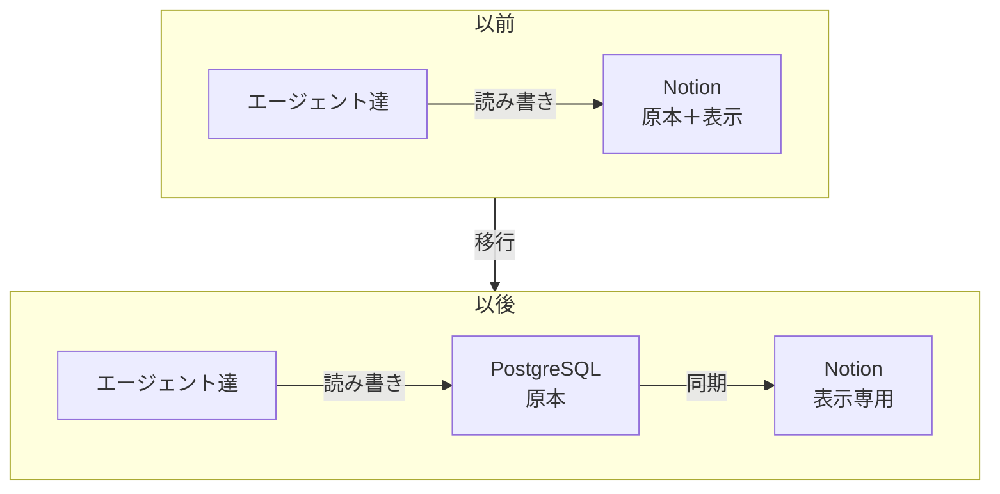

+++
date = '2026-08-21T23:00:00+09:00'
draft = false
title = '[2026-08-21] DBが原本、Notionはskin'
summary = "元帳の権威をNotionからPostgreSQLに移した。既存データは移行しないことにした。新しい実行からDB、過去のものはNotionにそのまま。"
tags = ['HIA']
+++

8月21日、HIAの元帳の権威をNotionからPostgreSQLに移動した。

---

## なぜ移したのか

HIAの元帳（ledger）はNotionページとして始まった。すべてのエージェントがNotionを読み書きして状態を共有していた。問題は**Notionが障害を起こすとシステム全体が止まる**ことだった。元帳はシステムの心臓であり、その心臓が外部サービスの可用性に依存していた。

決定は明確だった。**「DBが原本、Notionはskin。」** すべての判定はPostgreSQLで行い、Notionは人間が見やすいように表示するだけの層に降格した。Notionが落ちてもシステムは動き続ける。

## マイグレーションなし

Notionに蓄積された実行履歴（run history）をDBに移行しないことにした。

理由は単純だ。一人のシステムなので二重ストレージを許容できる。過去の記録はNotionにそのまま残り、新しい実行からDBに蓄積される。マイグレーションは作業量に対して得られるものが少ない——過去の記録を参照する必要があればNotionを直接見ればいい。

## 持ち込んだ原則、先送りしたもの

DBに移行しても**追記専用（append-only）の原則は維持した。** ドメインテーブルはINSERTのみ許可する。Notionで守っていた原則をDBでもそのまま踏襲した。

一方、CAS（Content-Addressable Storage）、監査チェーン（audit chain）、べき等キー（idempotency key）は先送りにした。有用だが今すぐ必要ではない。「エレガンスはコストだ」の原則に従い、必要になった時点で入れることにした。

| 決定 | 理由 |
|---|---|
| DBを原本に | Notion障害＝システム停止を防止 |
| Notionをskinとして維持 | 人間が見るには依然便利 |
| マイグレーションなし | 一人のシステム、二重ストレージ許容 |
| 追記専用を維持 | 原則はストレージが変わっても同じ |
| CAS・監査・べき等は先送り | 今は不要、必要時に追加 |
