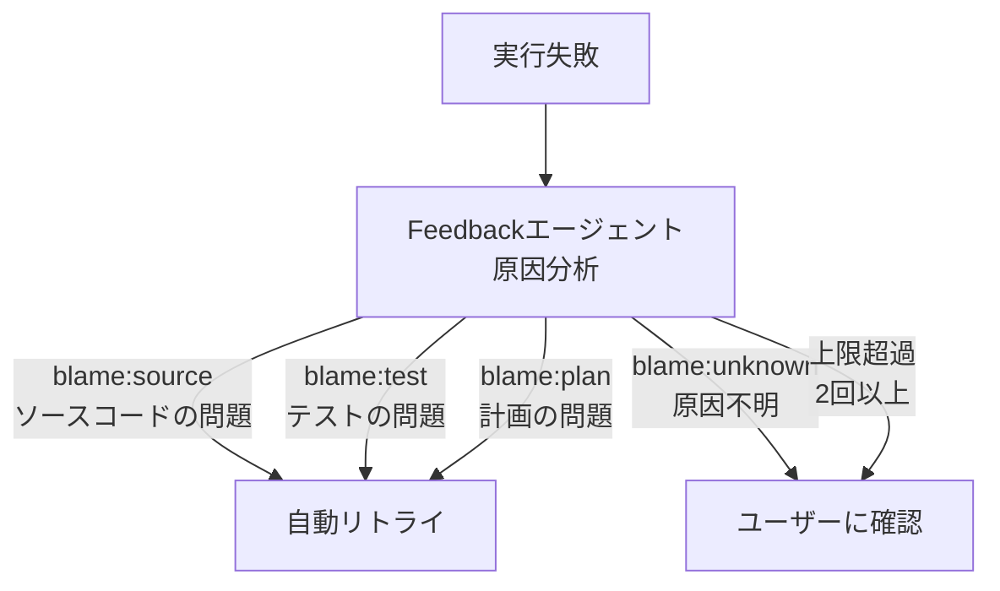

+++
date = '2026-08-23T23:00:00+09:00'
draft = false
title = '[2026-08-23] 確認せずにリトライせよ'
summary = "Chiefを独立プロセスからスキルに転換し、ベクトル検索の代わりにSQLを選んだ。最大の決定は自動リトライの許可——「ユーザーの同意なくリトライしない」という不変条件を廃棄した。"
tags = ['HIA']
+++

8月22日から23日まで、HIAのChiefを再設計し、自動リトライ体系を構築した。

---

## Chief独立プロセスの削除

Chiefは元々別プロセス（`bin/hia-chief`）として動いていた。ユーザーが明示的に維持を拒否した。**Claude Codeスキル（`/chief`）が唯一のインターフェースになった。**

これによりサブプロセス層が丸ごとなくなった。Claude Codeセッション自体がChiefの役割を果たす。実行（run）は数十分から数時間かかるためバックグラウンドで実行する。

## ベクトル検索の代わりにSQL

過去の実行履歴を検索する機能（RAG）を追加する際、ベクトル検索ではなく**SQLベースの検索**を選んだ。一人のシステムではすべてのデータがPostgreSQLに構造化されている。埋め込みモデルやベクトルDBなどのインフラを追加する理由がない。構造化されたデータには構造化されたクエリが合う。

## 自動リトライ——不変条件の廃棄

最大の決定だ。

これまで**「ユーザーの同意なくリトライしない」**という不変条件（invariant）があった。エージェントが失敗したら必ずユーザーに確認してからでなければ再試行しなかった。この不変条件を廃棄した。

失敗した実行（run）の原因を分析するFeedbackエージェントがblame（原因帰属）を残す。blameの種類に応じて：

**原因が明確な場合（source/test/plan）、ユーザーに確認せず即座にリトライする。** 原因が不明（`blame:unknown`）またはリトライ回数が上限（2回）を超えた場合は必ずユーザーに確認する。

同じ実行内でリトライするとblameの循環が発生するため、**新しい実行を作成して**失敗した役割から再開する方式を選んだ。

## 残った限界

Feedbackがblame:testを出してもTestBuilderのDONE状態が維持されて再作成が不可能という構造的限界を発見した。ステージ無効化（invalidation）メカニズムが必要だが今回は先送りにした。**限界を認識し記録したこと**自体が今回の作業の成果物だ。

| 決定 | 以前 | 以後 |
|---|---|---|
| Chief実行方式 | 独立プロセス | Claude Codeスキル |
| 履歴検索 | なし | SQLベースRAG |
| リトライポリシー | 常にユーザー確認 | blame明確時は自動 |
| リトライ上限 | なし | 2回 |
