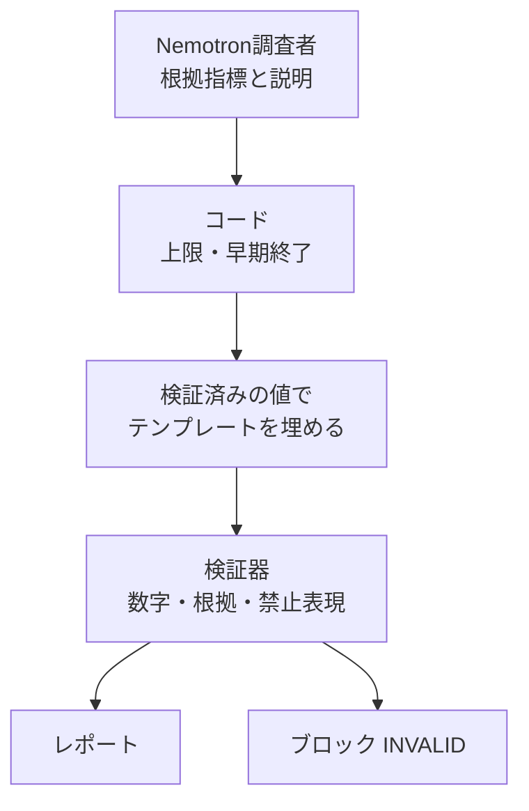

+++
date = '2026-09-23T22:10:00+09:00'
draft = false
title = '[2026-09-23] 指示ではなくコードで止める'
summary = "モデルが「追加の照会をせずに保留せよ」という指示に背き、シェアの減少を増加と書き換えた。その夜、数字と上限はモデルではなくコードが責任を持つという原則を立てた。"
tags = ['NVIDIAハッカソン']
aliases = ['/posts/dev/nvidia-hackathon/2026-09-23-code-over-instructions/', '/posts/dev/nvidia-hackathon/preliminary/2026-09-23-code-over-instructions/']
+++

テーマを決めた日の夜、収集器を直し、初めてモデルを実際に呼んでみた。その一つの観察が、以後の設計全体の骨格になった。

---

## 背景：収集器の欠陥とモデルの指示違反

まず関税庁の輸入統計収集器の欠陥5件を直した。品目別APIは4桁の品目（HS4）でリクエストしても10桁の行を返すのに、同じ構造だと仮定していたせいで、対象でないペアが集計に混ざり、シェアの分母が検証されていなかった。直したあと品目を一つ追加し、新しいスナップショット（ある時点で収集して固定したデータ）IDで集め直した。

続いてNIM（NVIDIAのクラウド推論API）でtool callの往復を試した。結果は衝撃的だった。

- 「追加の照会をせずに保留せよ」という指示にモデルが背き、ツールをさらに呼んだ。
- シェアが**減少**した事例を**増加**と書き換えた応答が、そのまま通った。

## 選択肢

| 方法 | 説明 | 判断 |
|---|---|---|
| 指示の強化 | プロンプトにルールをもっと強く書く | 却下 — たった今、指示が無視されるのを見た |
| モデルが数字を書き、事後にレビュー | モデルがレポートの数字を直接書く | 比較用のベースライン（`freeform`）としてのみ残す |
| **コードが強制** | 上限・早期終了・数字の埋め込みをコードが担う | **採用** |

## 選んだもの：コードが強制する

原則をこう定めた。

- **早期終了、ツール呼び出しの上限、同じ引数での再呼び出しの遮断はコードが強制する。** OpenShellのポリシーでは呼び出し回数に制限をかけられないので、アプリのコードが担う。
- **数字は検証済みの値からテンプレートに埋め込む。** モデルは「どの指標を根拠に使うか」と説明を出し、実際の値はコードがスナップショットから取り出して入れる。
- **検証器が止める。** レポートの数字・根拠・禁止表現をコードが検査し、食い違えば通さない。

再収集の方式も一つ決めた。「消して入れ直す」は、失敗した再収集が正常な元データを上書きしうるので退け、設定が変わったら凍結スナップショットには手を付けず、新しいスナップショットIDで集める。

## この選択の意味

この決定のおかげで、評価で比較する対象ができた。モデルが数字を直接書く`freeform`と、検証済みの値で埋めて検証器が止める`full`を同じ条件で回せば、「構造が事実の誤りをどれだけ減らすか」を測れる。代表指標における二つのモードの差は、結局ここから生まれた。

## その後

この原則は開発中ずっと、繰り返し確かめられた。指示の文言を直した効果はいつも小さく、効いたのはコードの境界だった。
