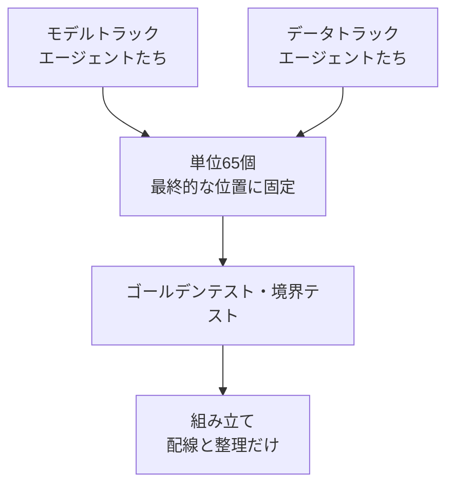

+++
date = '2026-09-24T17:20:00+09:00'
draft = false
title = '[2026-09-24] 65の単位に分けて作り、最後に組み立てる'
summary = "二つのトラックのエージェントが同時に実装できるよう、アプリを最小単位65個に分け、初日から最終的な位置に置くことにした。組み立てをファイルの移動なしに、配線と整理だけで終わらせるための選択だった。"
tags = ['NVIDIAハッカソン']
+++

計画ドキュメントが終わり、実装を控えた9月24日の午後、実装をどんな単位に分けるかを決めた。

---

## 背景：複数のエージェントが同時に直すと混ざる

二つのトラックのエージェントが、それぞれ6〜8個ずつ同時に働く予定だった。同じファイルを複数が直せば衝突が起き、あとで統合するときに何を捨てて何を合わせるかを判断する根拠が失われる。そこで三つの条件を出した。

1. ドメインごとにアプリを別々に実装してから組み立てることを基本とする。
2. ドメインを最小単位にさらに分ける。
3. 組み立てるとき、捨てるものと合わせるものを確認する。

名前と出力のルールも原文で渡した。「名前やルールは明確に。各ドメインの出力物は ./outputs/ に積む。」出力は実行ごとに`{ドメイン名}-{yymmddhhmmss}`フォルダに置き、封印セットの出力は`outputs/sealed/`に別に置く。

## 選択肢

| 案 | 内容 | 判断 |
|---|---|---|
| **A案** | モジュールをパッケージに変え、単位ファイルを初日から最終的な位置に置く（importパスは維持） | **採用** |
| B案 | パスはそのまま、単位をファイル内の関数として置く | 却下 — 関数単位では所有とレビューの境界がぼやける |
| C案 | 単位ごとにインストール可能なパッケージにする | 却下 — 5日間のプロジェクトにはパッケージングのコストが大きい |

## 選んだもの：A案

単位ファイルを初日から最終的な位置に置けば、組み立ては**ファイルを動かさず、配線と整理で**終わる。結果は、単位ID・ドメイン名・ファイル・所有者・組み立て判定の候補を記した単位表だった。最小単位は65個になった。

同じ日の夜、もう一つ決めた。アプリの骨格（S0）について外部の助言を受けることにしていたが、助言を待つあいだ、二つのトラックが始められずにいた。私は「外部助言はもう反映しない」と答え、未解決の問いは骨格の作業が提案し、オーケストレーターが決定記録として決めるようにした。

## この選択の意味

骨格S0は、パッケージ15個と境界テストを作った。境界テストは「独立採点器はアプリをimportしない」といったルールをコードを実行せずに強制し、わざと仕込んだ違反62件をすべて捉えた。単位ごとにゴールデンテスト（期待出力と比較するテスト）の枠を設け、単位同士の契約が食い違えばすぐに表に出るようにした。

## その後

翌日の組み立て点検（AS4）は、単位表の6段階の手順を回し、「合わせたものも捨てたものもない」と判定した。組み立ての直前にファイルを動かすことは一度もなかった。
