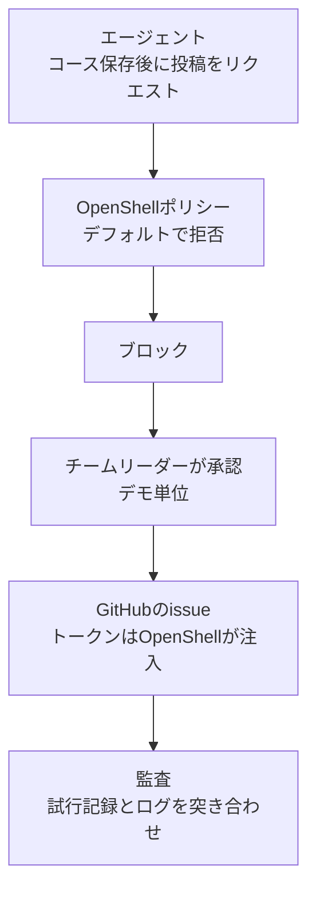

+++
date = '2026-10-07T12:00:00+09:00'
draft = false
title = '[2026-10-07] 投稿はブロックされ、承認すれば通る'
summary = "OpenShellを深く使う場面として「投稿ブロック → 承認 → 通過」を選んだ。あえてトークンの必要なGitHubのissue投稿を選び、トークンをOpenShellが代わりに入れるところまで見せることにした。"
tags = ['NVIDIAハッカソン']
+++

方向を決めたあと、設計の問いが一気に押し寄せた。そのうち、審査で40点がかかったOpenShellの活用に直接関わる決定を集めた。

---

## 背景：「サンドボックスで動かした」は活用ではない

予選のときに立てた基準があった。サンドボックスで動かしただけでは衛生にすぎず、中核のフローがポリシーによる遮断や認証情報の分離といった機能に**構造的に依存して**はじめて活用だ。そこで、コース保存後の「投稿」をポリシーがブロックし、人が承認すると開く場面を、デモの中心に置いた。

## 投稿先

| 案 | 判断 |
|---|---|
| キー不要の公開サービス（推奨案） | 却下 — トークンの注入を見せられない |
| ローカルの模擬掲示板 | 却下 — 実際の外部境界ではない |
| **トークンの必要なサービス（GitHub）** | **採用** — トークンをOpenShellが代わりに入れるところまで見せられる |

投稿先は**専用リポジトリのissue**に絞り、トークンもそのリポジトリのissue書き込み権限だけを持つものにした。最小権限、最も狭い承認ルールだ。45分以内にトークンの注入がうまくいかなければ、キー不要の公開サービスに切り替える代替経路も事前に承認しておいた。

トークンの登録方法も決めた。`.env`に入れてキーのラッパーを増やす案ではなく、**チームリーダーが自らターミナルでproviderとして登録**した。トークンは会話にも、ファイルにも、ログにも、どこにも残らない。

## あわせて決めた設計原則

- **根拠等級は4段階で、出典の種類を基準とし、コードが計算する。** 同じ資料なら同じ等級が出なければならない。モデルの判断に任せる案は退けた。
- **計画はモデルが先に立て、実行はコードが行う。** 毎ステップでモデルがツールを選ぶ方式より、記録と再現がしやすい。
- **secretsの場面**：アクセス禁止のフォルダを読み取りツールで実際に試し、拒否（EACCES）を意思決定の記録に残す。OpenShellはファイルの拒否をログに残さないので、ネットワークの拒否ログと対にして見せる。
- 運営情報で日付と等級が食い違うときは、両方を見せて「現地での確認が必要」と書く。

## 受け入れたこと

投稿承認の単位は、推奨案（1回限りの承認）ではなく**デモ単位**を選んだ。承認が開いているあいだは、ほかの実行も投稿できてしまうというリスクを承知のうえで受け入れた。5分の発表のなかで、承認の場面をなめらかに見せる必要があったからだ。

## その後

午後に違反テストを回した結果は、すべて予測と一致した。投稿はブロックされ、承認後にissueが実際に投稿され、承認を取り消した。監査スクリプトは、アプリの投稿試行の記録とOpenShellのログ21件をすべて突き合わせた。

