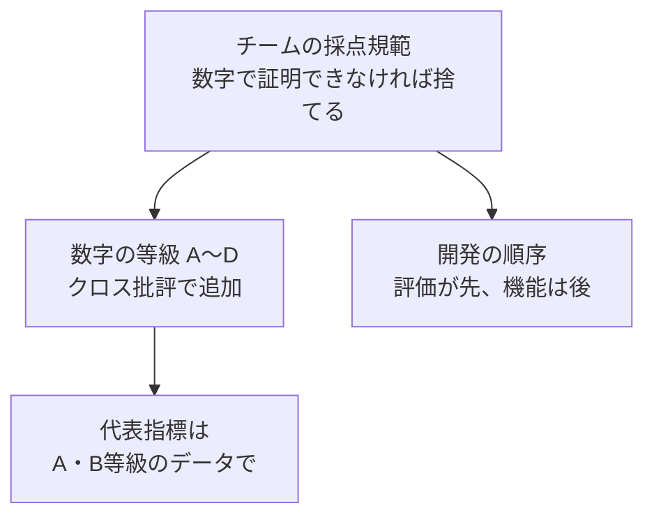

+++
date = '2026-09-22T23:00:00+09:00'
draft = false
title = '[2026-09-22] 数字で証明できないなら作らない'
summary = "NVIDIA Korea Agentic AI Hackathonの予選を始めるにあたり、アイデアより先に採点規範を立てた。最初の原則は「数字で証明できないアイデアは採用しない」だった。"
tags = ['NVIDIAハッカソン']
aliases = ['/posts/dev/nvidia-hackathon/2026-09-22-numbers-or-nothing/']
+++

2026 NVIDIA Korea Agentic AI Hackathon予選準備の初日、アイデアを選ぶ前に、アイデアをふるいにかける基準から作った。

---

## 背景：まず大会を読んだ

公式ページ、応募フォーム、DLI（NVIDIAの教育コース）の講義、build.nvidia.comを自分たちで確認し、調査ドキュメントを作った。予選の締め切りは9月28日23:59で、手順は「教育ミッションの確認 → NVIDIA APIを活用したデモ → 応募書類の提出」だった。審査項目は四つ（NVIDIA Agent技術活用の深さ、実用性・産業価値・革新性、完成度、独創性）だったが、配点は公開されていなかった。教育ミッションがNemoClaw（OpenShellの上でエージェントを動かすNVIDIAのリファレンススタック）とOpenShell（エージェントを隔離して動かすサンドボックスランタイム）だったので、技術スタックは事実上決まっていると考えた。

ここで浮かんだ考えは一つだった。**エージェントのデモは誰でも作る。** では、差はどこから生まれるのか。

## 選択肢

| 方向 | 内容 | 結果 |
|---|---|---|
| アイデア先行 | 面白いテーマを選んで機能を積み上げる | 却下 — デモ同士の区別がつかない |
| 技術の数で勝負 | NVIDIA技術をできるだけ多く組み込む | 却下 — 数は必然性ではない |
| **規範先行** | 数字で証明できるアイデアだけを残す | **採用** |

## 選んだもの：チームの採点規範

第一原理は「数字で証明できないアイデアは採用しない」だった。これにハードゲートを六つ（定量的証明、教育ミッションとの整合性、NVIDIA技術3種以上、再現可能性、産業上の課題であること、6日以内に完走できること）付けた。これは大会公式の配点ではなく、チームが自ら定めた設計ルールだ。この規範で候補10個をふるいにかけると、スケジュール・旅行、文書生成、汎用チャットボットのRAG（検索拡張生成）が脱落した。

その夜、候補を23個に広げてから、ChatGPTに「冷徹な審査員」の役を与えてクロス批評を受けた。指摘のうち三つを受け入れた。

- **技術の数を必然性と取り違えている** — 「OpenShellを取り除いても、それでも動くのか？」を問わなければならない。
- **数字を作れることと、その数字が証拠であることを混同している。**
- **核心の実験よりもプロダクトの物語を先に膨らませている。**

そこで規範v2.1に数字の等級を入れた。Aは外部ベンチマーク・実ラベル、Bは凍結されたheld-out、Cは独立に作った決定的なフィクスチャ、Dは「自分たちで作って自分たちで採点した合成データ」だ。代表指標はAかBでなければならない。

逆に退けた助言もある。ChatGPTは「二つの候補のどちらかに固定し、新しいアイデアを足すな」と言ったが、従わなかった。翌日、実務寄りに候補を広げる余地を残しておきたかった。

## この選択の意味

規範は開発の順序まで決めた。**評価スクリプトとベースラインが先、機能は後。** 結果を見てからルールを直さないためには、ルールが先になければならない。この順序が二日後の「ドキュメントが先、実装は次」という設計判断の根拠になり、数字の等級体系は代表指標を合成データではなく実データに移す根拠になった。

## その後

この規範は最後まで基準として残った。封印評価で形式エラーが出たとき、再採点せずに「A等級の主張を保留」と記した判断も、結局はこの日に立てた原則から来ている。
