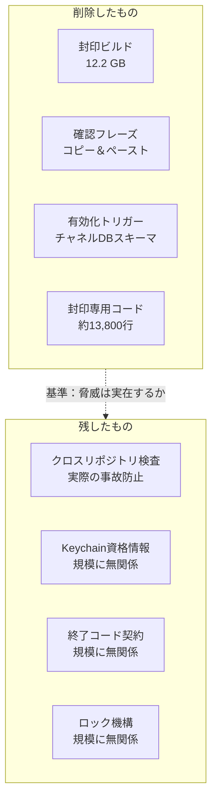

+++
date = '2026-08-08T23:00:00+09:00'
draft = false
title = '[2026-08-08] 不要な鎧を脱ぐ'
summary = "存在しない脅威を防ぐ保護層がプロジェクトを止めていた。13,800行を削除し、規模に関わらず正しいものだけを残した。"
tags = ['Second Brain']
+++

8月4日から8日まで、Second Brainの封印・有効化層（seal/activation layer）をすべて撤去した。

---

## なぜ全部撤去したのか

封印層は「知らないうちにコードが変更される可能性がある」という脅威を前提に設計されていた。封印ビルド（sealed build）を作成し、確認フレーズ（challenge phrase）を入力しなければ機能が解放されない構造だった。

しかしこのシステムは、一人が自分のMacで一人で使うシステムだ。コードを変えられるのは自分だけで、デプロイ経路も一つしかない。**防ごうとしていた脅威は存在しなかった。** そしてこの保護層がむしろプロジェクトを数週間にわたって止めていた原因だった——封印が失敗するたびに進行がブロックされ、再封印の手順自体が負担だった。

質問→回答の経路は封印とは無関係にすでに常時動作していた。撤去した跡に新しい機能は必要なかった。

## 何を削り、何を残したか

基準は単純だった。**「この仕組みが防ぐ脅威は実際に存在するか？」** 封印・確認フレーズ・有効化トリガーは存在しない脅威を防いでいた。一方、クロスリポジトリ検査は二つのプロセスが物理的な接点を共有する限り実際の事故を防ぐ。Keychainと終了コード契約はシステムの規模に関わらず正しい慣行だ。

## 決定のまとめ

| 選択肢 | 決定 | 理由 |
|---|---|---|
| 封印を一部残す vs 全部撤去 | **全部撤去** | 防ぐべき脅威が不在 |
| チャネルDBの移行 vs 新規作成 | **新規作成** | 有効化の残滓がスキーマのトリガーに埋め込まれ分離不可 |
| 確認フレーズを残す vs 削除 | **削除** | ホワイトリスト＋DMがすでに同じ役割 |
| 封印実体を保管 vs 削除 | **即座に削除** | 12.2 GB、再び使うことはない |

チャネルDBは新たに作ることにした。有効化状態がスキーマのトリガーとして埋め込まれていて分離ができなかったからだ。残滓を残すより、きれいに再出発する方を選んだ。
