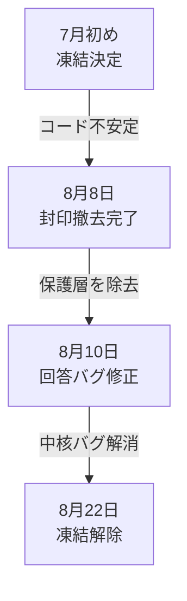

+++
date = '2026-08-23T23:00:00+09:00'
draft = false
title = '[2026-08-23] 凍結解除'
summary = "二ヶ月近く止めていた四つの機能をオンにした。分類器もより正確なモデルに交換した。凍結は慎重さだったし、解除もまた慎重さだった。"
tags = ['Second Brain']
+++

8月22日から23日まで、Second Brainで凍結されていた機能を有効化し、分類器を交換した。

---

## 四つの機能をオンにした

7月初めから止めていた四つの機能を明示的に有効化した。

- **ドリームサイクル**（dream cycle）——保存された記憶を定期的に再構成するバックグラウンドジョブ
- **合成レビュー**（synthetic review）——記憶の品質を自動で点検
- **スナップショット公開**（snapshot publish）——記憶の状態を外部にエクスポート
- **再エンゲージメントレビュー**（reengagement review）——長期間使われていない記憶に再び注意を向ける

コードは最初から存在していた。設定フラグがオフだっただけだ。以前の方針は**「封印が解除されるまでこれらの機能をオンにしない」**だった。封印はすでに撤去済み（8月8日）で、その後に回答廃棄のバグも修正したため、コードが十分に安定したと判断した。

再エンゲージメントレビューは**すべての記憶に適用する**ことにした。当初はコア記憶（shell memory）だけを対象にするか迷ったが、優先度シグナルは記憶の階層に依存しないと判断した。

## 分類器の交換

ユーザーの発話意図を判別する分類器（speech-act classifier）を交換した。

従来の分類器は入力文を小さなチャンクに分割し（`_split_chunks`）、各チャンクの意図を個別に判別していた。問題は分割の過程で文脈が破壊されることだった。「週末に何をしたっけ？」を「週末に」と「何をしたっけ？」に分割すると、各断片だけでは意図を判断できない。

根本原因は分割アルゴリズムではなく、**チャンク単位で分類する設計そのもの**だった。文書全体を一度に見て判別する方式に分類器を交換した。

| 項目 | 以前 | 以後 |
|---|---|---|
| 分類単位 | 文チャンク | 文書全体 |
| 文脈保持 | 分割で損失 | 全体維持 |

既存の分割関数（`_split_chunks`）は他の箇所でも使われていたため削除しなかった。分類器のみ交換した。
