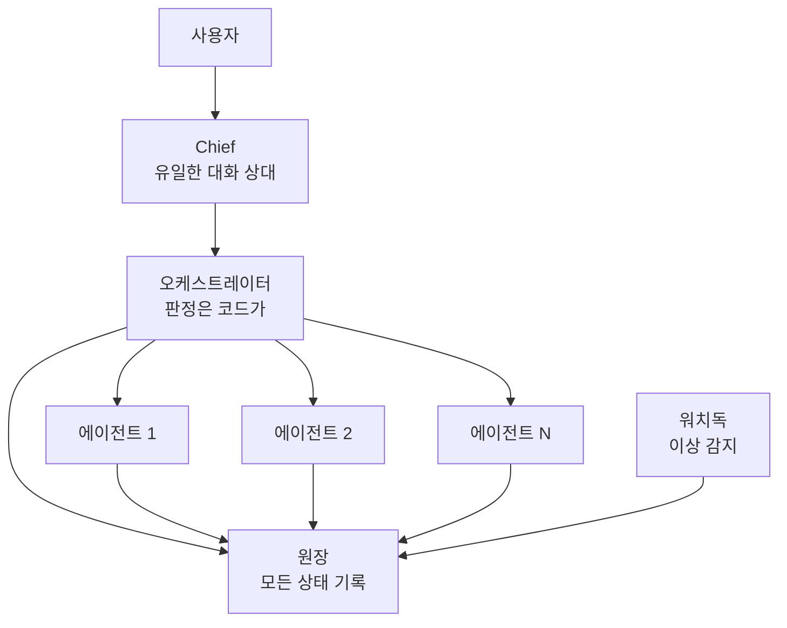

+++
date = '2026-08-16T23:00:00+09:00'
draft = false
title = '[2026-08-16] 우아함은 비용이다'
summary = "개인용 Agent OS를 만들기 시작했다. 첫 번째 원칙은 '우아함은 비용이다' — 읽는 사람 없는 쓰기 경로를 만들지 않기로 했다."
tags = ['HIA']
+++

8월 15일부터 16일까지 HIA(Hermes-Inspired Architecture)의 기초를 놓았다.

---

## HIA란 무엇인가

HIA는 1인 사용자를 위한 개인용 Agent OS다. 전문 에이전트 팀이 직렬로 협업하고, 사용자는 Chief 하나와만 대화한다. 핵심 원칙은 세 가지다:

1. **상태는 전부 원장(ledger)에** — 에이전트 머릿속이 아니라 공유 장부에 기록
2. **판정은 전부 코드가** — 모델은 내용만 만들고, 다음 단계를 정하는 건 코드
3. **우아함은 비용이다** — 이벤트 소싱, 타입 계층, 4계층 모듈 경계 같은 것을 만들지 않는다

## 세 가지 설계 결정

**첫째, 헤드리스(headless, 화면 없는 실행)를 선택했다.** 에이전트가 터미널 세션 안에서 대화하는 대신, 백그라운드에서 실행되고 결과만 원장에 기록한다. 이렇게 하면 스트리밍 출력과 실행 중 개입(interrupt) 기능을 잃는다. 대신 리셋과 재실행을 결정론적으로 제어할 수 있게 된다. **잃는 것을 알고 선택했다.**

**둘째, 서드파티 런타임 의존을 0으로 정했다.** 운영 추가 비용이 제로여야 한다. 혼자 쓰는 도구에 외부 서비스 과금이나 관리 부담을 지지 않겠다는 결정이다. (나중에 PostgreSQL 드라이버 하나만 예외로 허용했다 — 줄바꿈 처리에서 서브프로세스 방식이 실패했기 때문이다.)

**셋째, "우아함은 비용이다."** 이벤트 소싱, 타입 계층, 4계층 모듈 경계 — 이런 것들은 팀이 크고 코드를 읽는 사람이 많을 때 값어치를 한다. 1인 시스템에서는 **읽는 사람 없는 쓰기 경로만 늘린다.** 전부 제외했다.

## 결과

이틀 만에 4구역 원장(PLAN·STATE·LOG·STATUS), 오케스트레이터, 워치독, Chief, 플로우 엔진이 동작하게 됐다. "우아함은 비용이다"를 실증한 셈이다 — 구조를 단순하게 가져가니 빠르게 돌아가는 것을 만들 수 있었다.
