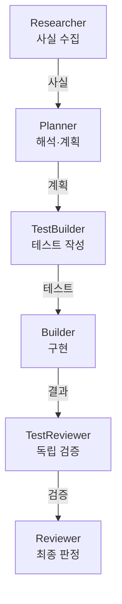

+++
date = '2026-08-17T23:00:00+09:00'
draft = false
title = '[2026-08-17] 사실과 해석을 분리하라'
summary = "Agent OS의 역할을 넷에서 여섯으로 늘렸다. 핵심은 조사와 계획의 분리, 그리고 에이전트의 자기보고를 불신하는 원칙이었다."
tags = ['HIA']
+++

8월 17일, HIA의 에이전트 역할을 4개에서 6개로 확장했다.

---

## 왜 역할을 나눴나

기존 구조에서는 Planner가 조사와 계획을 모두 담당했다. 문제는 **사실 수집과 해석이 한 에이전트 안에서 뒤섞인다**는 것이었다. "이 코드가 어떻게 동작하는가"(사실)와 "그래서 어떻게 고쳐야 하는가"(해석)는 성격이 다른 작업이다. 한 에이전트가 둘 다 하면 자기가 수집한 사실에 맞춰 해석을 끼워 맞추는 경향이 생긴다.

**Researcher를 추가했다.** 사실만 수집하고 해석하지 않는 역할이다. Planner는 Researcher가 수집한 사실을 받아서 계획을 세운다.

## 에이전트의 자기보고를 불신하라

Builder가 "테스트를 통과했습니다"라고 보고하면, 그 말을 그대로 믿을 수 있을까? **믿지 않기로 했다.**

**TestReviewer를 추가했다.** Builder가 작성한 코드와 테스트 결과를 독립적으로 검증하는 역할이다. Builder의 "통과" 보고가 아니라 TestReviewer의 검증 결과가 다음 단계 진행 여부를 결정한다.

## 넣지 않은 것

Feedback(실패 원인 분석)과 Janitor(정리) 역할은 이 시점에서 넣지 않았다. HIA는 직렬 1회 실행(한 번 흘러가면 끝) 구조였기 때문에, 실패 피드백을 다음 실행으로 넘기는 구조가 아직 없었다. 없는 구조에 역할만 만들면 빈 껍데기가 된다.

판정 enum(열거형)도 도입하지 않았다. 원장의 DONE/FAILED이 곧 판정이다. 1인 시스템에서 형식을 위한 형식은 불필요하다.

## 결정 요약

| 결정 | 이유 |
|---|---|
| Researcher 추가 | 사실과 해석의 분리 |
| TestReviewer 추가 | 에이전트 자기보고 불신 |
| Feedback·Janitor 미도입 | 직렬 1회 실행에서 역할 없음 |
| 판정 enum 미도입 | DONE/FAILED이면 충분 |
