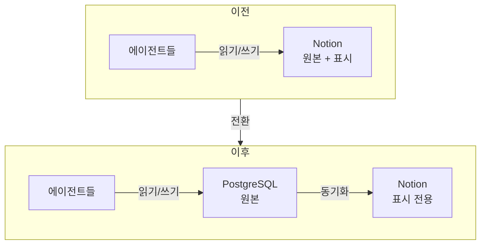

+++
date = '2026-08-21T23:00:00+09:00'
draft = false
title = '[2026-08-21] DB가 원본, Notion은 skin'
summary = "원장의 권위를 Notion에서 PostgreSQL로 옮겼다. 기존 데이터는 마이그레이션하지 않기로 했다. 새 실행부터 DB, 과거는 Notion에 그대로."
tags = ['HIA']
+++

8월 21일, HIA의 원장 권위를 Notion에서 PostgreSQL로 이동했다.

---

## 왜 옮겼나

HIA의 원장(ledger)은 Notion 페이지로 시작했다. 모든 에이전트가 Notion을 읽고 쓰면서 상태를 공유했다. 문제는 **Notion이 장애를 일으키면 시스템 전체가 멈춘다**는 것이었다. 원장이 곧 시스템의 심장인데, 그 심장이 외부 서비스의 가용성에 달려 있었다.

결정은 명확했다. **"DB가 원본, Notion은 skin."** 모든 판정은 PostgreSQL에서 일어나고, Notion은 사람이 보기 편하게 표시만 해주는 계층으로 강등했다. Notion이 죽어도 시스템은 계속 돌아간다.

## 마이그레이션 안 함

기존 Notion에 쌓인 실행 기록(run history)을 DB로 옮기지 않기로 했다.

이유는 단순하다. 1인 시스템이므로 이중 저장소를 허용할 수 있다. 과거 기록은 Notion에 그대로 있고, 새 실행부터 DB에 쌓인다. 마이그레이션은 작업량에 비해 얻는 것이 적다 — 과거 기록을 참조할 일이 있으면 Notion을 직접 보면 된다.

## 가져간 원칙, 미룬 것

DB로 옮기면서도 **append-only(추가 전용) 원칙은 유지했다.** 도메인 테이블은 INSERT만 허용한다. 기존에 Notion에서 지켰던 원칙을 DB에서도 그대로 따랐다.

반면 CAS(Content-Addressable Storage), audit chain(감사 추적), idempotency key(멱등성 키)는 미뤘다. 이것들은 유용하지만 지금 당장 필요하지는 않다. "우아함은 비용이다" 원칙에 따라, 필요해지는 시점에 넣기로 했다.

| 결정 | 이유 |
|---|---|
| DB를 원본으로 | Notion 장애 = 시스템 정지 방지 |
| Notion을 skin으로 유지 | 사람이 보기엔 여전히 편리 |
| 마이그레이션 안 함 | 1인 시스템, 이중 저장소 허용 |
| append-only 유지 | 원칙은 저장소가 바뀌어도 동일 |
| CAS·감사 추적·멱등성 미룸 | 지금은 불필요, 필요 시 추가 |
