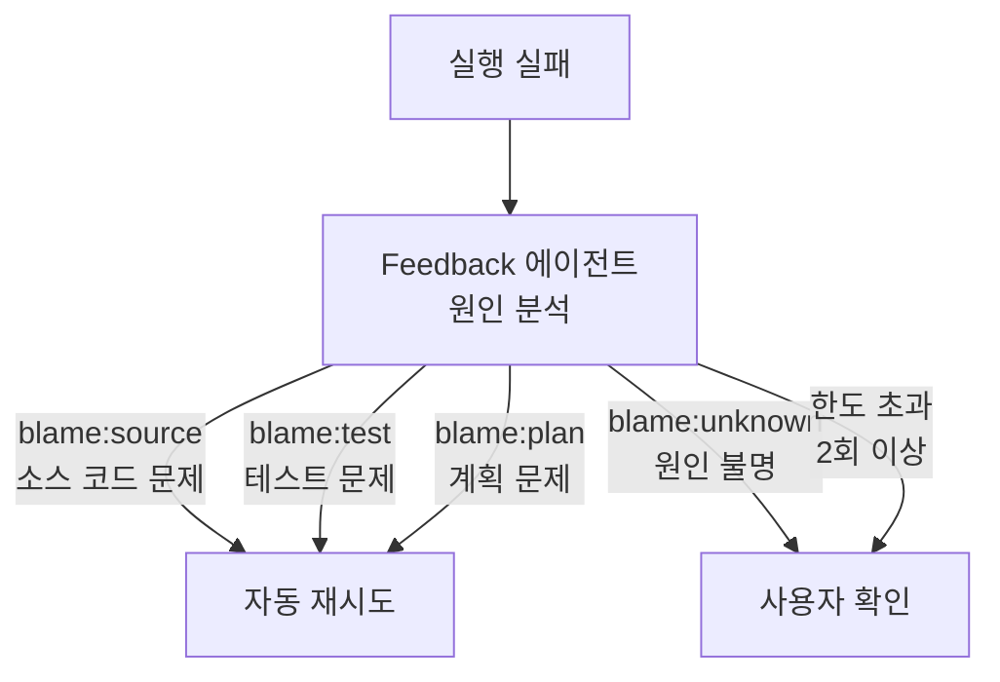

+++
date = '2026-08-23T23:00:00+09:00'
draft = false
title = '[2026-08-23] 사용자 확인 없이 재시도하라'
summary = "Chief를 독립 프로세스에서 스킬로 전환하고, 벡터 검색 대신 SQL을 택했다. 가장 큰 결정은 자동 재시도를 허용한 것이다 — '사용자 동의 없이 재시도하지 않는다'는 불변을 폐기했다."
tags = ['HIA']
+++

8월 22일부터 23일까지 HIA의 Chief를 재설계하고 자동 재시도 체계를 만들었다.

---

## Chief 독립 프로세스 삭제

Chief는 원래 별도 프로세스(`bin/hia-chief`)로 돌아갔다. 사용자가 명시적으로 유지를 거부했다. **Claude Code 스킬(`/chief`)이 유일한 인터페이스가 됐다.**

이로써 서브프로세스 계층이 통째로 사라졌다. Claude Code 세션 자체가 Chief 역할을 한다. 실행(run)은 수십 분에서 수시간 걸리므로 백그라운드로 돌린다.

## 벡터 검색 대신 SQL

과거 실행 이력을 검색하는 기능(RAG)을 넣으면서, 벡터 검색 대신 **SQL 기반 검색**을 택했다. 1인 시스템에서 모든 데이터가 PostgreSQL에 구조화되어 있다. 임베딩 모델이나 벡터 DB 같은 인프라를 추가할 이유가 없다. 구조화된 데이터에는 구조화된 쿼리가 맞다.

## 자동 재시도 — 불변의 폐기

가장 큰 결정이다.

이전까지 **"사용자 동의 없이 재시도하지 않는다"**는 불변(invariant)이 있었다. 에이전트가 실패하면 반드시 사용자에게 물어본 뒤에만 다시 시도했다. 이 불변을 폐기했다.

실패한 실행(run)의 원인을 분석하는 Feedback 에이전트가 blame(원인 귀속)을 남긴다. blame의 종류에 따라:

**원인이 명확하면(source/test/plan) 사용자 확인 없이 즉시 재시도한다.** 원인을 모르거나(`blame:unknown`) 재시도 횟수가 한도(2회)를 넘으면 반드시 사용자에게 묻는다.

같은 실행 안에서 재시도하면 blame 순환이 발생하므로, **새 실행을 만들어서** 실패한 역할부터 재시작하는 방식을 택했다.

## 남은 한계

Feedback이 blame:test를 내려도 TestBuilder의 DONE 상태가 유지되어 재작성이 불가능한 구조적 한계를 발견했다. 단계 무효화(invalidation) 메커니즘이 필요하지만 이번에는 미뤘다. **한계를 인식하고 기록한 것** 자체가 이번 작업의 산출물이다.

| 결정 | 이전 | 이후 |
|---|---|---|
| Chief 실행 방식 | 독립 프로세스 | Claude Code 스킬 |
| 이력 검색 | 없음 | SQL 기반 RAG |
| 재시도 정책 | 항상 사용자 확인 | blame 명확 시 자동 |
| 재시도 한도 | 없음 | 2회 |
