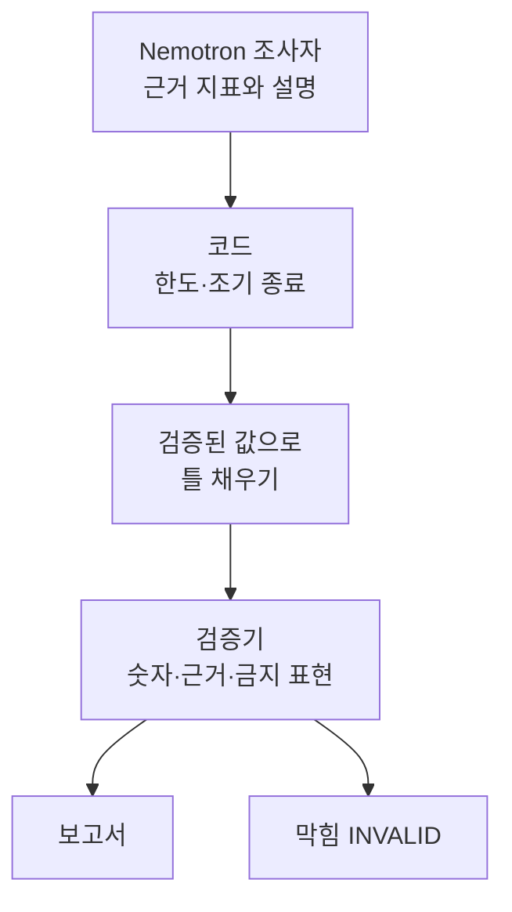

+++
date = '2026-09-23T22:10:00+09:00'
draft = false
title = '[2026-09-23] 지시가 아니라 코드로 막는다'
summary = "모델이 '추가 조회 없이 보류하라'는 지시를 어기고 점유율 감소를 증가로 뒤집어 썼다. 그날 밤 숫자와 한도는 모델이 아니라 코드가 책임진다는 원칙을 세웠다."
tags = ['NVIDIA 해커톤']
aliases = ['/posts/dev/nvidia-hackathon/2026-09-23-code-over-instructions/', '/posts/dev/nvidia-hackathon/preliminary/2026-09-23-code-over-instructions/']
+++

주제를 정한 날 밤, 수집기를 고치고 모델을 처음 실제로 불러 봤다. 그 관찰 하나가 이후 설계 전체의 뼈대가 됐다.

---

## 배경: 수집기 결함과 모델의 지시 위반

먼저 관세청 수입통계 수집기의 결함 다섯 건을 고쳤다. 품목별 API는 4자리 품목(HS4)으로 요청해도 10자리 행을 돌려주는데, 같은 구조로 가정한 탓에 대상이 아닌 쌍이 집계에 섞이고 점유율 분모가 검증되지 않았다. 고친 뒤 품목 하나를 더해 새 스냅샷(한 시점에 수집해 고정한 자료) ID로 다시 모았다.

이어 NIM(NVIDIA 클라우드 추론 API)의 tool call 왕복을 시험했다. 결과가 충격적이었다.

- "추가 조회 없이 보류하라"는 지시를 모델이 어기고 도구를 더 불렀다.
- 점유율이 **감소**한 사례를 **증가**로 뒤집어 쓴 응답이 그대로 통과했다.

## 선택지

| 방법 | 설명 | 판단 |
|---|---|---|
| 지침 강화 | 프롬프트에 규칙을 더 세게 적는다 | 버림 — 방금 지침이 무시되는 것을 봤다 |
| 모델이 숫자를 쓰고 사후 검토 | 모델이 보고서 숫자를 직접 쓴다 | 비교용 기준선(`freeform`)으로만 남김 |
| **코드가 강제** | 한도·조기 종료·숫자 채우기를 코드가 맡는다 | **채택** |

## 고른 것: 코드가 강제한다

원칙을 이렇게 정했다.

- **조기 종료, 도구 호출 한도, 같은 인자 재호출 차단은 코드가 강제한다.** OpenShell 정책으로는 호출 횟수를 걸 수 없으니 앱 코드가 맡는다.
- **숫자는 검증된 값에서 틀로 채운다.** 모델은 "어떤 지표를 근거로 쓸지"와 설명을 내고, 실제 값은 코드가 스냅샷에서 꺼내 넣는다.
- **검증기가 막는다.** 보고서의 숫자·근거·금지 표현을 코드가 검사해 어긋나면 통과시키지 않는다.

재수집 방식도 하나 정했다. "지우고 다시 넣기"는 실패한 재수집이 정상 원자료를 덮어쓸 수 있어 버렸고, 설정이 바뀌면 동결 스냅샷을 고치지 않고 새 스냅샷 ID로 모은다.

## 이 선택의 의미

이 결정 덕분에 평가에서 비교할 거리가 생겼다. 모델이 숫자를 직접 쓰는 `freeform`과, 검증된 값으로 채우고 검증기가 막는 `full`을 같은 조건으로 돌리면 "구조가 사실 오류를 얼마나 줄이는가"를 잴 수 있다. 대표 지표의 두 모드 차이는 결국 여기서 나왔다.

## 그 뒤

이 원칙은 개발 내내 반복해서 확인됐다. 지침 문구를 고친 효과는 늘 작았고, 효과가 있었던 것은 코드 경계였다.
