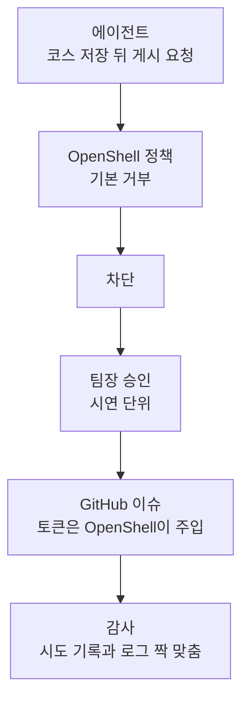

+++
date = '2026-10-07T12:00:00+09:00'
draft = false
title = '[2026-10-07] 게시는 막히고, 승인하면 통과한다'
summary = "OpenShell을 깊게 쓰는 장면으로 '게시 차단 → 승인 → 통과'를 골랐다. 일부러 토큰이 필요한 GitHub 이슈 게시를 택해, 토큰을 OpenShell이 대신 넣는 것까지 보이기로 했다."
tags = ['NVIDIA 해커톤']
+++

방향을 정한 뒤 설계 질문이 한꺼번에 쏟아졌다. 그 가운데 심사 40점이 걸린 OpenShell 활용과 직접 닿는 결정들을 모았다.

---

## 배경: "샌드박스에서 돌렸다"는 활용이 아니다

예선 때 세운 기준이 있었다. 샌드박스에서 돌린 것만으로는 위생일 뿐이고, 핵심 흐름이 정책 차단이나 자격 증명 분리 같은 기능에 **구조적으로 기대야** 활용이다. 그래서 코스 저장 뒤의 "게시"를 정책이 막고, 사람이 승인하면 열리는 장면을 시연의 중심에 두었다.

## 게시 대상

| 안 | 판단 |
|---|---|
| 키 없는 공개 서비스(권장안) | 버림 — 토큰 주입을 보일 수 없다 |
| 로컬 모형 게시판 | 버림 — 실제 외부 경계가 아니다 |
| **토큰이 필요한 서비스(GitHub)** | **채택** — 토큰을 OpenShell이 대신 넣는 것까지 보인다 |

게시 위치는 **전용 저장소의 이슈**로 좁혔고, 토큰도 그 저장소 이슈 쓰기 권한만 가진 것으로 만들었다. 최소 권한, 가장 좁은 승인 규칙이다. 45분 안에 토큰 주입이 안 되면 키 없는 공개 서비스로 가는 대체 경로도 미리 승인해 뒀다.

토큰 등록 방식도 정했다. `.env`에 넣고 키 래퍼를 늘리는 안 대신, **팀장이 직접 터미널에서 provider로 등록**했다. 토큰이 대화, 파일, 로그 어디에도 남지 않는다.

## 함께 정한 설계 원칙

- **근거 등급은 4단계, 출처 종류 기준, 코드가 계산한다.** 같은 자료면 같은 등급이 나와야 한다. 모델 판단에 맡기는 안은 버렸다.
- **계획은 모델이 먼저 세우고, 실행은 코드가 한다.** 매 단계 모델이 도구를 고르는 방식보다 기록과 재현이 쉽다.
- **secrets 장면**: 접근 금지 폴더를 읽기 도구로 실제로 시도하고, 거부(EACCES)를 의사결정 기록에 남긴다. OpenShell은 파일 거부를 로그에 남기지 않기 때문에, 네트워크 거부 로그와 짝지어 보인다.
- 운영 정보에서 날짜와 등급이 엇갈리면 둘 다 보이고 "현장 확인 필요"라고 적는다.

## 감수한 것

게시 승인의 단위는 권장안(1회용 승인)이 아니라 **시연 단위**로 골랐다. 승인이 열려 있는 동안 다른 실행도 게시될 수 있다는 위험을 알고 받아들였다. 5분 발표 안에 승인 장면을 매끄럽게 보여야 했기 때문이다.

## 그 뒤

오후에 위반 시험을 돌린 결과 예측과 모두 일치했다. 게시는 차단됐다가, 승인 뒤 이슈가 실제로 올라갔고, 승인을 회수했다. 감사 스크립트는 앱의 게시 시도 기록과 OpenShell 로그 21건을 모두 짝지었다.

