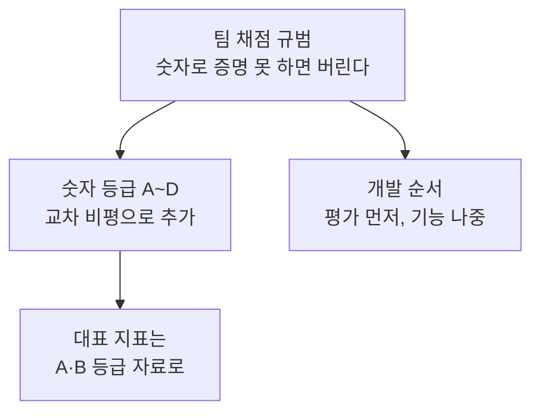

+++
date = '2026-09-22T23:00:00+09:00'
draft = false
title = '[2026-09-22] 숫자로 증명할 수 없으면 만들지 않는다'
summary = "NVIDIA Korea Agentic AI Hackathon 예선을 시작하며 아이디어보다 먼저 채점 규범을 세웠다. 첫 원칙은 '숫자로 증명할 수 없는 아이디어는 채택하지 않는다'였다."
tags = ['NVIDIA 해커톤']
aliases = ['/posts/dev/nvidia-hackathon/2026-09-22-numbers-or-nothing/']
+++

2026 NVIDIA Korea Agentic AI Hackathon 예선 준비 첫날, 아이디어를 고르기 전에 아이디어를 거를 기준부터 만들었다.

---

## 배경: 대회를 먼저 읽었다

공식 페이지, 신청 폼, DLI(NVIDIA 교육 과정) 강의, build.nvidia.com을 직접 확인해 조사 문서를 만들었다. 예선 마감은 9월 28일 23:59였고, 절차는 "교육 미션 확인 → NVIDIA API 활용 데모 → 신청서 제출"이었다. 심사 항목은 네 가지(NVIDIA Agent 기술 활용 심도, 실용성·산업가치·혁신성, 완성도, 독창성)였지만 배점은 공개되지 않았다. 교육 미션이 NemoClaw(OpenShell 위에서 에이전트를 돌리는 NVIDIA 참조 스택)와 OpenShell(에이전트를 격리해 돌리는 샌드박스 런타임)이었으니, 기술 스택은 사실상 정해져 있다고 봤다.

여기서 든 생각은 하나였다. **에이전트 데모는 누구나 만든다.** 그렇다면 차이는 어디서 나는가.

## 선택지

| 방향 | 내용 | 결과 |
|---|---|---|
| 아이디어 먼저 | 재미있는 주제를 고르고 기능을 쌓는다 | 버림 — 데모끼리 구별되지 않는다 |
| 기술 개수로 승부 | NVIDIA 기술을 최대한 많이 붙인다 | 버림 — 개수는 필연성이 아니다 |
| **규범 먼저** | 숫자로 증명할 수 있는 아이디어만 남긴다 | **채택** |

## 고른 것: 팀 채점 규범

제1원리는 "숫자로 증명할 수 없는 아이디어는 채택하지 않는다"였다. 여기에 하드 게이트 여섯 개(정량 증명, 교육 미션 정합성, NVIDIA 기술 3종 이상, 재현 가능성, 산업 문제성, 6일 안에 완주)를 붙였다. 이것은 대회 공식 배점이 아니라 팀이 스스로 정한 설계 규칙이다. 이 규범으로 후보 10개를 거르자 일정·여행, 문서 생성, 범용 챗봇 RAG(검색 증강 생성)가 탈락했다.

그날 밤 후보를 23개로 넓힌 뒤 ChatGPT에 "냉정한 심사위원" 역할을 주고 교차 비평을 받았다. 지적 가운데 세 가지를 받아들였다.

- **기술 개수를 필연성으로 착각한다** — "OpenShell을 지워도 여전히 작동하는가?"를 물어야 한다.
- **숫자를 만들 수 있다는 것과 그 숫자가 증거라는 것을 혼동한다.**
- **핵심 실험보다 제품 서사를 먼저 키운다.**

그래서 규범 v2.1에 숫자 등급을 넣었다. A는 외부 벤치마크·실제 라벨, B는 동결된 held-out, C는 독립적으로 만든 결정적 픽스처, D는 "우리가 만들고 우리가 채점한 합성 자료"다. 대표 지표는 A나 B여야 한다.

반대로 버린 권고도 있다. ChatGPT는 "두 후보 중 하나로 고정하고 새 아이디어를 더하지 말라"고 했지만 따르지 않았다. 다음 날 현업 쪽으로 후보를 넓힐 여지를 남기고 싶었다.

## 이 선택의 의미

규범은 개발 순서까지 정했다. **평가 스크립트와 기준선을 먼저, 기능은 나중.** 결과를 본 뒤 규칙을 고치지 않으려면 규칙이 먼저 있어야 한다. 이 순서가 이틀 뒤 "문서 먼저, 구현은 다음"이라는 설계 결정의 근거가 됐고, 숫자 등급 체계는 대표 지표를 합성 자료가 아니라 실자료로 옮기는 근거가 됐다.

## 그 뒤

이 규범은 끝까지 기준으로 남았다. 봉인 평가에서 형식 오류가 났을 때 재채점하지 않고 "A등급 주장 보류"로 적은 판단도 결국 이날 세운 원칙에서 나왔다.
