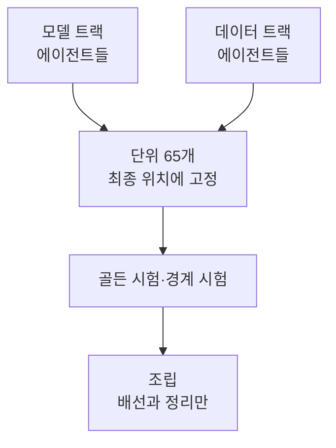

+++
date = '2026-09-24T17:20:00+09:00'
draft = false
title = '[2026-09-24] 65개 단위로 쪼개 만들고 마지막에 조립한다'
summary = "두 트랙의 에이전트가 동시에 구현하도록, 앱을 최소 단위 65개로 쪼개 첫날부터 최종 위치에 두기로 했다. 조립이 파일 옮기기 없이 배선과 정리로 끝나게 하려는 선택이었다."
tags = ['NVIDIA 해커톤']
aliases = ['/posts/dev/nvidia-hackathon/2026-09-24-units-then-assemble/']
+++

계획 문서가 끝나고 구현을 앞둔 9월 24일 오후, 구현을 어떤 단위로 나눌지 정했다.

---

## 배경: 여러 에이전트가 동시에 고치면 섞인다

두 트랙의 에이전트가 6~8개씩 동시에 일할 예정이었다. 같은 파일을 여럿이 고치면 충돌이 나고, 나중에 합칠 때 무엇을 버리고 무엇을 합칠지 판단할 근거가 사라진다. 그래서 세 가지 조건을 냈다.

1. 도메인별로 앱을 따로 구현한 뒤 조립하는 것을 기초로 한다.
2. 도메인을 최소 단위로 다시 나눈다.
3. 조립할 때 버릴 것과 합칠 것을 확인한다.

이름과 출력 규칙도 원문으로 줬다. "이름이나 규칙은 명확하게. 각 도메인별 출력물은 ./outputs/에 쌓는다." 출력은 실행마다 `{도메인명}-{yymmddhhmmss}` 폴더에 두고, 봉인 묶음 출력은 `outputs/sealed/`에 따로 둔다.

## 선택지

| 안 | 내용 | 판단 |
|---|---|---|
| **A안** | 모듈을 패키지로 바꾸고 단위 파일을 첫날부터 최종 위치에 둔다(import 경로 유지) | **채택** |
| B안 | 경로는 그대로, 단위를 파일 안의 함수로 둔다 | 버림 — 함수 단위는 소유와 검토 경계가 흐려진다 |
| C안 | 단위마다 설치 패키지로 만든다 | 버림 — 5일짜리 프로젝트에 패키징 비용이 크다 |

## 고른 것: A안

단위 파일을 첫날부터 최종 위치에 두면, 조립은 **파일을 옮기지 않고 배선과 정리로** 끝난다. 결과는 단위 ID·도메인명·파일·소유·조립 판정 후보를 적은 단위 표였다. 최소 단위는 65개가 됐다.

같은 날 밤 하나를 더 정했다. 앱 뼈대(S0)에 대해 외부 자문을 받기로 했는데, 자문을 기다리는 동안 두 트랙이 시작하지 못하고 있었다. 나는 "외부자문은 더이상 반영없어"라고 답했고, 열린 질문은 뼈대 작업이 제안하고 오케스트레이터가 결정 기록으로 정하게 했다.

## 이 선택의 의미

뼈대 S0는 패키지 15개와 경계 시험을 만들었다. 경계 시험은 "독립 채점기는 앱을 import하지 않는다" 같은 규칙을 코드 실행 없이 강제했고, 일부러 심은 위반 62건을 모두 잡았다. 단위마다 골든 시험(기대 출력과 비교하는 시험) 자리를 두어, 단위끼리 계약이 어긋나면 바로 드러나게 했다.

## 그 뒤

다음 날 조립 점검(AS4)은 단위 표의 여섯 단계 절차를 돌려 "합친 것도 버린 것도 없다"고 판정했다. 조립 직전에 파일을 옮기는 일은 한 번도 없었다.
