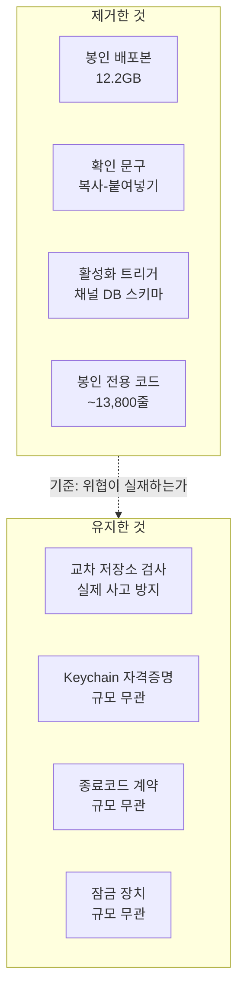

+++
date = '2026-08-08T23:00:00+09:00'
draft = false
title = '[2026-08-08] 불필요한 갑옷을 벗다'
summary = "1인 시스템에 존재하지 않는 위협을 막는 보호 계층이 프로젝트를 멈추게 한 원인이었다. 13,800줄을 지우고, 규모와 무관하게 옳은 것만 남겼다."
tags = ['Second Brain']
+++

8월 4일부터 8일까지 세컨드 브레인의 봉인·활성화 계층(seal/activation layer)을 전부 걷어냈다.

---

## 왜 전부 철거했나

봉인 계층은 "모르는 사이 코드가 바뀔 수 있다"는 위협을 전제로 설계됐다. 배포본(sealed build)을 만들고, 확인 문구(challenge phrase)를 입력해야만 기능이 열리는 구조였다.

그런데 이 시스템은 한 사람이 자기 맥에서 혼자 쓰는 시스템이다. 코드를 바꿀 사람은 나뿐이고, 배포 경로도 하나뿐이다. **막으려던 위협이 존재하지 않았다.** 그리고 이 보호 계층이 오히려 프로젝트를 몇 주째 멈추게 한 원인이었다 — 봉인이 실패할 때마다 진행이 차단됐고, 재봉인 절차 자체가 부담이었다.

질문→답변 경로는 봉인과 무관하게 이미 상시 동작하고 있었다. 없앤 자리에 새 기능이 필요하지 않았다.

## 무엇을 지우고, 무엇을 남겼나

기준은 단순했다. **"이 장치가 막는 위협이 실제로 존재하는가?"** 봉인·확인 문구·활성화 트리거는 존재하지 않는 위협을 막고 있었다. 반면 교차 저장소 검사는 두 프로세스가 물리적 접점을 공유하는 한 실제 사고를 막는다. Keychain과 종료코드 계약은 시스템 규모와 무관하게 올바른 관행이다.

## 결정 요약

| 선택지 | 결정 | 이유 |
|---|---|---|
| 봉인 일부 유지 vs 전부 철거 | **전부 철거** | 막으려던 위협이 부재 |
| 채널 DB 마이그레이션 vs 새로 시작 | **새로 시작** | 활성화 잔재가 스키마에 박혀 분리 불가 |
| 확인 문구 유지 vs 제거 | **제거** | 화이트리스트+DM이 이미 같은 역할 |
| 봉인 실물 보관 vs 삭제 | **즉시 삭제** | 12.2GB, 다시 쓸 일 없음 |

채널 DB는 새로 만들기로 했다. 활성화 상태가 스키마의 트리거로 박혀 있어서 분리가 불가능했기 때문이다. 잔재를 남기느니 깨끗하게 다시 시작하는 쪽을 택했다.
