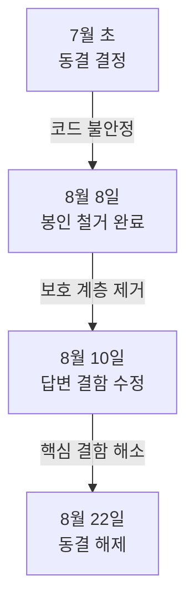

+++
date = '2026-08-23T23:00:00+09:00'
draft = false
title = '[2026-08-23] 동결 해제'
summary = "두 달 가까이 꺼두었던 네 가지 기능을 켰다. 분류기도 더 정확한 모델로 교체했다. 동결은 신중함이었고, 해제도 신중함이었다."
tags = ['Second Brain']
+++

8월 22일부터 23일까지 세컨드 브레인에서 동결된 기능을 활성화하고 분류기를 교체했다.

---

## 네 기능을 켰다

7월 초부터 꺼두었던 네 가지 기능을 명시적으로 활성화했다.

- **드림 사이클**(dream cycle) — 저장된 기억을 주기적으로 재구성하는 백그라운드 작업
- **합성 리뷰**(synthetic review) — 기억의 품질을 자동으로 점검
- **스냅샷 게시**(snapshot publish) — 기억 상태를 외부에 내보내기
- **재참여 리뷰**(reengagement review) — 오래 안 쓴 기억에 다시 주의를 기울이기

코드는 처음부터 존재했다. 설정 플래그만 꺼져 있었을 뿐이다. 이전에 정해둔 방침은 **"봉인 해제 전까지 이 기능들을 켜지 않는다"**였다. 봉인을 이미 철거했고(8월 8일), 그 사이 답변 결함도 수정했으므로, 이제 코드가 충분히 안정됐다고 판단했다.

재참여 리뷰는 **모든 기억에 적용**하기로 했다. 처음에는 핵심 기억(shell memory)만 대상으로 할까 고민했지만, 우선순위 신호는 기억의 계층과 무관하다고 판단했다.

## 분류기 교체

사용자의 발화 의도를 분류하는 분류기(speech-act classifier)를 교체했다.

기존 분류기는 입력 문장을 작은 조각으로 쪼갠 뒤(`_split_chunks`) 각 조각의 의도를 판별했다. 문제는 쪼개는 과정에서 문맥이 파괴되는 것이었다. "내가 주말에 뭘 하지?"를 "내가 주말에"와 "뭘 하지?"로 나누면 각 조각만으로는 의도를 알 수 없다.

근본 원인은 분할 알고리즘이 아니라 **조각 단위로 분류하는 설계 자체**였다. 분류기를 문서 전체를 한 번에 보고 판별하는 방식으로 교체했다.

| 항목 | 이전 | 이후 |
|---|---|---|
| 분류 단위 | 문장 조각 | 문서 전체 |
| 문맥 보존 | 쪼개면서 손실 | 전체 유지 |

기존 분할 함수(`_split_chunks`)는 다른 곳에서도 쓰이고 있어 삭제하지 않았다. 분류기만 교체했다.
